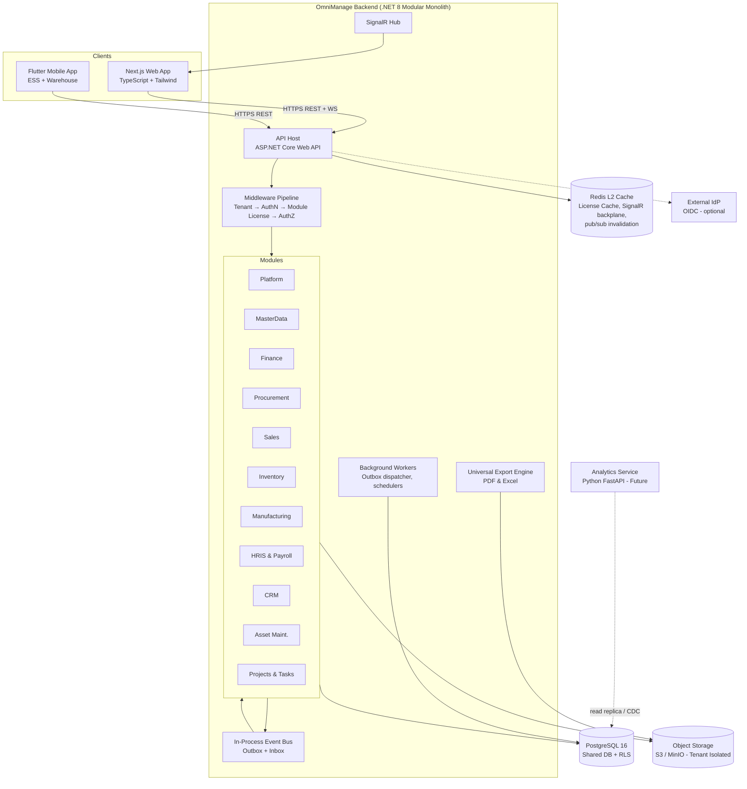
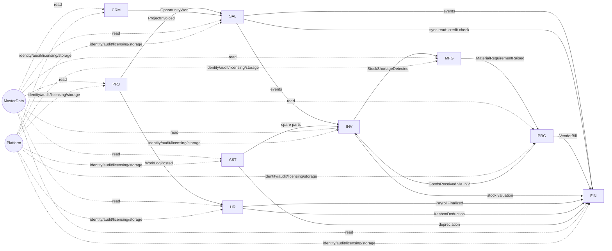
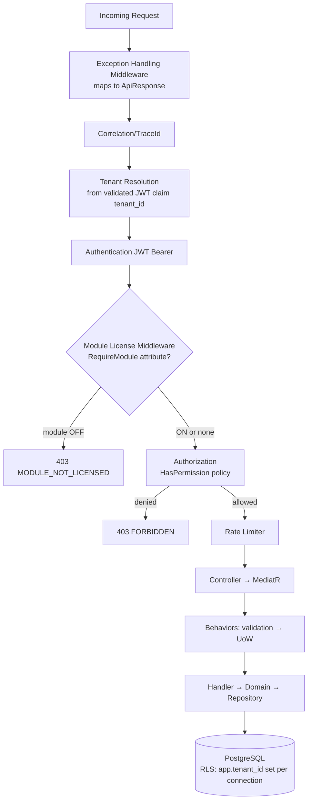
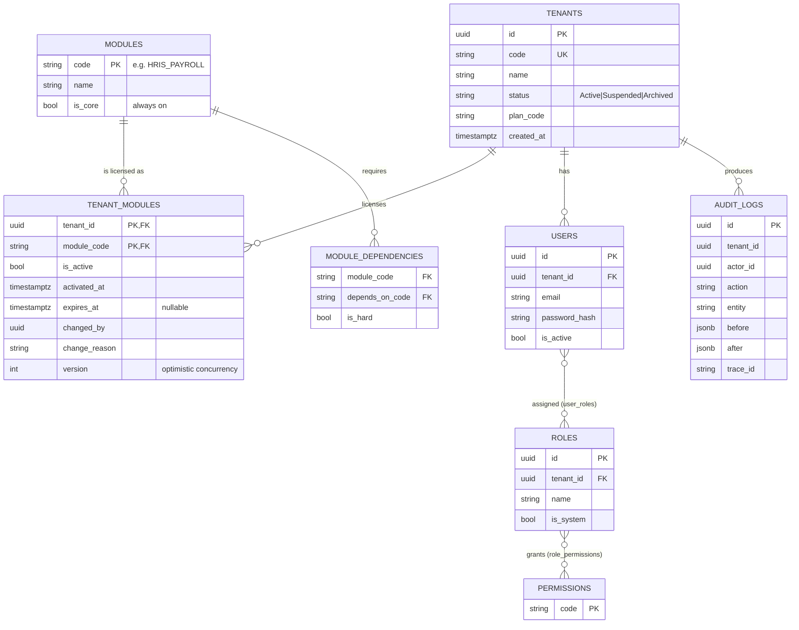
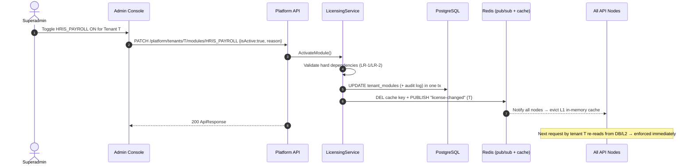
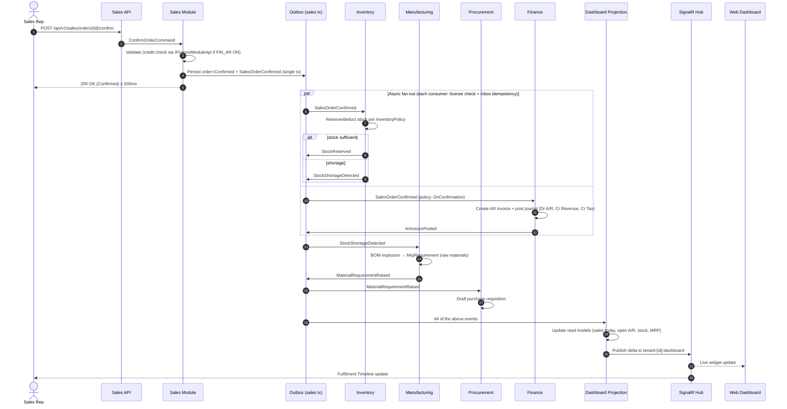

# OmniManage — Architecture Specification

> **AI agent directive:** This is the structural contract. Violating dependency rules in §4 is a build failure (enforced by architecture tests). When unsure where code belongs, apply the decision table in §4.3.

---

## 1. Architectural Principles
1. **Modular Monolith, API-first.** One deployable backend. Strict module boundaries enforce independence, so a module can later be extracted into a service without redesign.
2. **Clean Architecture inside every module** (Domain → Application → Infrastructure → Presentation). Dependencies point inward.
3. **Modules communicate only via contracts**, either synchronous in-process interfaces (queries) or asynchronous integration events (commands/facts). Never through another module's tables, DbContext or internal types.
4. **Every business row is tenant-scoped.** Tenant isolation is enforced twice: EF Core global query filter AND PostgreSQL Row-Level Security.
5. **Every module is licensable.** Licensing is enforced at the HTTP edge (middleware), the event consumer (inbox guard) and the UI (navigation).
6. **Eventual consistency between modules, strong consistency inside a module.**
7. **Idempotent everything** at boundaries (commands from mobile, events between modules).

---

## 2. System Context & Containers



---

## 3. Solution & Folder Structure

```
omnimanage/
├── docs/                                  # PRD.md DESIGN.md Architecture.md Security.md Rules.md + adr/
├── backend/
│   ├── OmniManage.sln
│   ├── Directory.Build.props              # nullable enable, warnings as errors, analyzers
│   ├── Directory.Packages.props           # central package management
│   ├── src/
│   │   ├── Host/
│   │   │   └── OmniManage.Api/            # composition root ONLY (no business logic)
│   │   │       ├── Program.cs
│   │   │       ├── Middleware/            # ExceptionHandling, TenantResolution, ModuleLicense, RequestLogging
│   │   │       ├── Extensions/            # ServiceCollectionExtensions, ApplicationBuilderExtensions
│   │   │       └── appsettings*.json
│   │   ├── BuildingBlocks/
│   │   │   ├── OmniManage.BuildingBlocks.Domain/          # Entity, AggregateRoot, ValueObject, IDomainEvent, ITenantEntity, Result
│   │   │   ├── OmniManage.BuildingBlocks.Application/     # ICommand/IQuery, behaviors (validation, logging, tx), IModuleLicenseChecker, IStorageService, IExportEngine
│   │   │   ├── OmniManage.BuildingBlocks.Infrastructure/  # Outbox/Inbox, tenant interceptors, audit interceptor, base DbContext, S3Storage, RedisCache
│   │   │   └── OmniManage.BuildingBlocks.Contracts/       # IIntegrationEvent, ApiResponse<T>, ErrorCodes, ModuleCodes
│   │   └── Modules/
│   │       ├── Platform/                  # Identity, Tenancy, Licensing, Audit, Notifications, Approvals
│   │       ├── MasterData/
│   │       ├── Finance/
│   │       ├── Procurement/
│   │       ├── Sales/
│   │       ├── Inventory/
│   │       ├── Manufacturing/
│   │       ├── Hris/                      # Core HR, Smart Attendance, Payroll, Kasbon, PPh21
│   │       ├── Crm/
│   │       ├── AssetMaintenance/          # Asset Register, QR Code Scanning, Depreciation, Work Orders
│   │       └── Projects/                  # Clients, Projects, Tasks, Work Logs, KPI Generator
│   └── tests/
│       ├── OmniManage.Architecture.Tests/ # NetArchTest: layer + module boundary rules
│       └── <Module>.{UnitTests,IntegrationTests}/
├── frontend/                              # Next.js app (see DESIGN.md §8)
├── mobile/                                # Flutter app (feature-first, Clean Architecture)
├── analytics/                             # Python FastAPI (future phase)
└── infra/                                 # docker-compose, k8s/helm, terraform, CI pipelines

```

### 3.1 Module Anatomy (example: `Sales`)

```
Modules/Sales/
├── OmniManage.Modules.Sales.Domain/
│   ├── Orders/            SalesOrder.cs (aggregate), SalesOrderLine.cs, SalesOrderStatus.cs, Events/SalesOrderConfirmedDomainEvent.cs
│   ├── Quotations/
│   └── Abstractions/      ISalesOrderRepository.cs
├── OmniManage.Modules.Sales.Application/
│   ├── Orders/
│   │   ├── ConfirmOrder/  ConfirmOrderCommand.cs, ConfirmOrderHandler.cs, ConfirmOrderValidator.cs
│   │   ├── CreateOrder/
│   │   └── GetOrderById/  GetOrderByIdQuery.cs, GetOrderByIdHandler.cs, OrderDto.cs
│   ├── IntegrationEventHandlers/   # reacts to other modules' events
│   └── DependencyInjection.cs
├── OmniManage.Modules.Sales.Infrastructure/
│   ├── Persistence/       SalesDbContext.cs, Configurations/, Migrations/, Repositories/
│   └── SalesInfrastructureModule.cs
├── OmniManage.Modules.Sales.Contracts/            # PUBLIC surface (the only project others may reference)
│   ├── IntegrationEvents/ SalesOrderConfirmedIntegrationEvent.cs (versioned)
│   └── Api/               ISalesModuleApi.cs (sync read facade), DTOs
└── OmniManage.Modules.Sales.Presentation/
    └── Controllers/       SalesOrdersController.cs  ([RequireModule("SALES_CORE")])

```

### 3.2 Module Registration Contract

```csharp
// BuildingBlocks.Application
public interface IModule
{
    string ModuleCode { get; }                       // e.g. "SALES_CORE"
    IReadOnlyCollection<string> HardDependencies { get; }
    void RegisterServices(IServiceCollection services, IConfiguration configuration);
    void RegisterIntegrationEventHandlers(IIntegrationEventSubscriber subscriber);
}

// Host: Program.cs
var modules = new IModule[]
{
    new PlatformModule(), new MasterDataModule(), new FinanceModule(), new SalesModule(),
    new InventoryModule(), new ManufacturingModule(), new ProcurementModule(),
    new HrisModule(), new CrmModule(), new AssetMaintenanceModule(), new ProjectsModule()
};
foreach (var m in modules) m.RegisterServices(builder.Services, builder.Configuration);
builder.Services.AddSingleton<IModuleCatalog>(new ModuleCatalog(modules));

```

> A multi-code module (e.g., Finance = `FIN_GL`, `FIN_AR`, `FIN_AP`; HRIS = `HRIS_CORE`, `HRIS_ATTENDANCE`, `HRIS_PAYROLL`, `HRIS_ESS`) exposes sub-feature codes via `ModuleCodes` constants in `BuildingBlocks.Contracts`. Controllers and handlers declare the specific sub-code they need.

---

## 4. Dependency & Boundary Rules

### 4.1 Layer Dependency Rules (inside a module)

| Layer | May reference | MUST NOT reference |
| --- | --- | --- |
| Domain | `BuildingBlocks.Domain` | Application, Infrastructure, Presentation, EF Core, ASP.NET, any NuGet infra |
| Application | Domain, `BuildingBlocks.Application`, **other modules' `Contracts` only** | Infrastructure, Presentation, other modules' Domain/Application/Infrastructure |
| Infrastructure | Application, Domain, `BuildingBlocks.Infrastructure` | Presentation, other modules' anything except `Contracts` |
| Presentation | Application, `Contracts`, `BuildingBlocks.Contracts` | Domain entities (return DTOs only), Infrastructure |
| Host | All modules' Presentation + Infrastructure registration | — (composition only) |

### 4.2 Module Dependency Graph (Contracts-level)



### 4.3 "Where does this code go?" Decision Table

| Question | Placement |
| --- | --- |
| Pure business rule/invariant? | Domain (aggregate method) |
| Orchestrates a use case (load, call domain, save)? | Application handler |
| Needs DB/HTTP/file/clock? | Interface in Application/Domain, implementation in Infrastructure |
| Needed by another module? | Expose in `Contracts` (event or read-facade interface). Never expose entities |
| Reused across ALL modules? | `BuildingBlocks` (only if truly generic and non-business) |
| Shape of HTTP request/response? | Presentation (request DTOs) and Application (result DTOs) |

### 4.4 Enforced by Architecture Tests (CI-blocking)

```csharp
[Fact] public void Domain_Should_Not_Depend_On_Infrastructure() { /* NetArchTest */ }
[Fact] public void Modules_Should_Only_Reference_Other_Modules_Contracts() { /* … */ }
[Fact] public void Every_Controller_Should_Have_RequireModule_Or_AllowWithoutModule() { /* reflection */ }
[Fact] public void Every_TenantEntity_Should_Implement_ITenantEntity() { /* … */ }
[Fact] public void Every_Integration_Event_Should_Be_Immutable_And_Versioned() { /* … */ }

```

---

## 5. CQRS & Request Pipeline (Application layer)

* **MediatR** for commands/queries and in-module domain events.
* Pipeline behaviors, in order: `LoggingBehavior` → `ModuleLicenseBehavior` (defense-in-depth for non-HTTP callers like jobs/consumers) → `ValidationBehavior` (FluentValidation) → `UnitOfWorkBehavior` (transaction + outbox flush) → handler.
* **Commands** mutate state, return `Result`/`Result<T>`. **Queries** are read-only, may use `AsNoTracking()` or Dapper over read-optimized SQL, and never return domain entities.
* Domain events are dispatched **before commit** for in-module consistency. Integration events are written to the **outbox in the same transaction** and dispatched **after commit**.

### 5.1 HTTP Request Pipeline



> Middleware order in `Program.cs`: `UseExceptionHandling` → `UseCorrelation` → `UseAuthentication` → `UseTenantResolution` → `UseModuleLicense` → `UseAuthorization` → `UseRateLimiter` → `MapControllers`. (Tenant resolution requires authenticated claims. Anonymous endpoints such as login resolve the tenant from the request body/host header.)

---

## 6. Inter-Module Communication

### 6.1 Integration Events (async, default)

```csharp
// BuildingBlocks.Contracts
public interface IIntegrationEvent
{
    Guid EventId { get; }
    Guid TenantId { get; }
    DateTime OccurredOnUtc { get; }
    int SchemaVersion { get; }
    string? CorrelationId { get; }
}

// Sales.Contracts
public sealed record SalesOrderConfirmedIntegrationEvent(
    Guid EventId, Guid TenantId, DateTime OccurredOnUtc, int SchemaVersion, string? CorrelationId,
    Guid SalesOrderId, string OrderNumber, Guid CustomerId, string CurrencyCode,
    decimal SubTotal, decimal TaxTotal, decimal GrandTotal,
    IReadOnlyList<SalesOrderConfirmedLine> Lines) : IIntegrationEvent;

public sealed record SalesOrderConfirmedLine(Guid ItemId, decimal Quantity, string UomCode, decimal UnitPrice, decimal LineTotal);

// Hris.Contracts (Phase 6 Expansion)
public sealed record PayrollFinalizedIntegrationEvent(
    Guid EventId, Guid TenantId, DateTime OccurredOnUtc, int SchemaVersion, string? CorrelationId,
    Guid PayrollRunId, string PeriodCode, decimal TotalBasicSalary, decimal TotalAllowances,
    decimal TotalDeductions, decimal TotalKasbonDeducted, decimal TotalTaxPPh21, decimal NetPayTotal) : IIntegrationEvent;

```

**Rules:** events are immutable records, past-tense named, carry all data consumers need (no callbacks to the producer), and are additive-only within a `SchemaVersion`. Breaking changes require a new version and parallel support.

### 6.2 Transactional Outbox + Inbox

```csharp
// BuildingBlocks.Infrastructure
public sealed class OutboxMessage
{
    public Guid Id { get; init; }
    public Guid TenantId { get; init; }
    public string Type { get; init; } = default!;        // assembly-qualified/short type key
    public string Payload { get; init; } = default!;     // JSON
    public DateTime OccurredOnUtc { get; init; }
    public DateTime? ProcessedOnUtc { get; set; }
    public int Attempts { get; set; }
    public string? Error { get; set; }
}

public sealed class InboxMessage     // idempotency + license-skip tracking
{
    public Guid EventId { get; init; }
    public string Consumer { get; init; } = default!;    // handler identity
    public Guid TenantId { get; init; }
    public InboxStatus Status { get; set; }              // Processed | Skipped_ModuleDisabled | Failed | DeadLetter
    public DateTime ProcessedOnUtc { get; set; }
}   // PK = (EventId, Consumer)

```

**Dispatcher:** a background worker polls `outbox_messages WHERE processed_on_utc IS NULL ORDER BY occurred_on_utc FOR UPDATE SKIP LOCKED LIMIT n`, resolves subscribers, and invokes each in a new DI scope with the tenant context restored from `TenantId`. Failures use exponential backoff (max 5 attempts), then are flagged `DeadLetter` and surfaced in an admin **Event Monitor** with a **Replay** action.

**Consumer guard (license-aware):**

```csharp
// Wrapper around every IIntegrationEventHandler<T>
if (!await _license.IsActiveAsync(evt.TenantId, handler.RequiredModuleCode, ct))
{
    await _inbox.MarkAsync(evt.EventId, handler.Name, InboxStatus.Skipped_ModuleDisabled, ct);
    return;
}
if (await _inbox.AlreadyProcessedAsync(evt.EventId, handler.Name, ct)) return;   // idempotency
await handler.HandleAsync(evt, ct);
await _inbox.MarkAsync(evt.EventId, handler.Name, InboxStatus.Processed, ct);

```

### 6.3 Synchronous Cross-Module Queries (rare)

Allowed ONLY via `Contracts` facades (e.g., `IFinanceModuleApi.GetCustomerCreditExposureAsync`, `IHrisModuleApi.GetEmployeeActiveKasbonAsync`). They must be read-only, fast (< 50 ms), tolerant of the target module being OFF (return a neutral default through a `Result` and the caller continues), and never mutate the target module.

### 6.4 Sagas / Compensation

Multi-step business processes (e.g., order fulfilment) use **choreography** with explicit compensating events (`SalesOrderCancelled` → release stock → reverse AR). Introduce an orchestrated saga (state machine persisted in the module DB) only when a process has > 4 participants or complex timeouts.

---

## 7. Multi-Tenancy Strategy

### 7.1 Options Evaluated

| Criterion | Shared DB + `tenant_id` (+RLS) | Schema-per-tenant | DB-per-tenant |
| --- | --- | --- | --- |
| Isolation strength | Medium → **High with RLS** | High | Highest |
| Ops cost at 500+ tenants | **Low** | High (migrations × N schemas) | Very high |
| Migration complexity | **One migration** | N migrations | N migrations |
| Cross-tenant analytics / platform ops | **Easy** | Moderate | Hard |
| Noisy-neighbor control | Weak (mitigate by quotas) | Moderate | Strong |
| Per-tenant backup/restore | Hard | Moderate | **Easy** |
| Fit for dynamic module licensing | **Excellent** (module tables always exist, access controlled by flag) | Complex | Complex |

### 7.2 Decision (ADR-001)

**Default: shared database, shared schemas per module, `tenant_id` on every business table, enforced by EF Core global filters AND PostgreSQL RLS.**

* PostgreSQL **schemas are used per module** (`platform`, `masterdata`, `finance`, `sales`, `inventory`, `procurement`, `manufacturing`, `hris`, `crm`, `assets`, `projects`) to mirror module boundaries. This also enables a future module-to-service extraction.
* **Enterprise tier upgrade path:** a tenant can be migrated to a dedicated database. `ITenantConnectionResolver` returns a connection string per tenant (default: shared). No handler/domain code changes. Design all code to resolve the connection through this abstraction.
* Every module owns its own `DbContext`, mapped to its own schema and migrations history table (`__EFMigrationsHistory` in the module schema). **No cross-schema foreign keys** except to `platform.tenants`. Cross-module references are stored as plain GUIDs plus denormalized snapshot fields where needed.

### 7.3 Tenant Resolution

```csharp
public interface ITenantContext { Guid TenantId { get; } bool IsSuperadminContext { get; } }

// Middleware: read tenant_id from validated JWT claim (NEVER from a client-supplied header on authenticated routes).
// Anonymous routes (login, forgot password): resolve by subdomain/tenant code in the request, validate against platform.tenants.

```

### 7.4 Application-Level Enforcement (EF Core)

```csharp
public interface ITenantEntity { Guid TenantId { get; } }

public abstract class TenantDbContext(DbContextOptions options, ITenantContext tenant) : DbContext(options)
{
    protected override void OnModelCreating(ModelBuilder mb)
    {
        foreach (var et in mb.Model.GetEntityTypes().Where(t => typeof(ITenantEntity).IsAssignableFrom(t.ClrType)))
        {
            // global query filter: e => e.TenantId == tenant.TenantId
            var param = Expression.Parameter(et.ClrType, "e");
            var body = Expression.Equal(
                Expression.Property(param, nameof(ITenantEntity.TenantId)),
                Expression.Property(Expression.Constant(tenant), nameof(ITenantContext.TenantId)));
            et.SetQueryFilter(Expression.Lambda(body, param));
        }
    }
}
// A SaveChanges interceptor stamps TenantId on Added entities and THROWS if a modified/added entity has a different TenantId.

```

### 7.5 Database-Level Enforcement (PostgreSQL RLS)

```sql
-- Applied to EVERY tenant table by a migration helper (never hand-written ad hoc)
ALTER TABLE sales.sales_orders ENABLE ROW LEVEL SECURITY;
ALTER TABLE sales.sales_orders FORCE ROW LEVEL SECURITY;

CREATE POLICY tenant_isolation ON sales.sales_orders
  USING      (tenant_id = current_setting('app.tenant_id', true)::uuid)
  WITH CHECK (tenant_id = current_setting('app.tenant_id', true)::uuid);

```

```csharp
// Sets the tenant GUC on EVERY opened connection (Npgsql pooling-safe)
public sealed class TenantConnectionInterceptor(ITenantContext tenant) : DbConnectionInterceptor
{
    public override async Task ConnectionOpenedAsync(DbConnection conn, ConnectionEndEventData e, CancellationToken ct = default)
    {
        await using var cmd = conn.CreateCommand();
        cmd.CommandText = "SELECT set_config('app.tenant_id', @t, false)";
        var p = cmd.CreateParameter(); p.ParameterName = "t"; p.Value = tenant.TenantId.ToString(); cmd.Parameters.Add(p);
        await cmd.ExecuteNonQueryAsync(ct);
    }
}

```

**DB roles:** `omni_migrator` (owner, runs DDL, used only in CI/CD), `omni_app` (runtime, **NOT** owner, **NO** `BYPASSRLS`), `omni_readonly` (analytics replica). With no tenant set, `current_setting(..., true)` yields NULL and thus **zero rows** (fail-closed).
**Platform (superadmin) data** lives in the `platform` schema (no tenant RLS) and is accessed ONLY through `PlatformDbContext`. It never touches tenant business tables.

### 7.6 Core Tenancy & Licensing Schema



```sql
CREATE TABLE platform.tenant_modules (
    tenant_id     uuid         NOT NULL REFERENCES platform.tenants(id),
    module_code   varchar(50)  NOT NULL REFERENCES platform.modules(code),
    is_active     boolean      NOT NULL DEFAULT false,
    activated_at  timestamptz,
    expires_at    timestamptz,
    changed_by    uuid         NOT NULL,
    change_reason text,
    version       integer      NOT NULL DEFAULT 1,
    PRIMARY KEY (tenant_id, module_code)
);
CREATE INDEX ix_tenant_modules_active ON platform.tenant_modules (tenant_id) WHERE is_active;

```

> The entity is named `TenantModule` (table `tenant_modules`). It satisfies the logical `TenantModules(tenant_id, module_code, is_active)` requirement and adds audit/expiry columns. A module is effectively ACTIVE iff `is_active = true AND (expires_at IS NULL OR expires_at > now())`.

---

## 8. Dynamic Module Licensing (Runtime Architecture)



**Cache design (`ITenantModuleCache`):**

* L1: `IMemoryCache` (TTL 60 s). L2: Redis (TTL 5 min). Source: DB.
* Key: `license:{tenantId}` → a `HashSet<string>` of active module codes (one read per request, not per module).
* Invalidation: explicit on change (pub/sub) plus TTL as a safety net. **Fail-closed:** if the license source is unreachable and no cache exists, deny with `503 LICENSE_UNAVAILABLE`.
* The session endpoint (`GET /api/v1/auth/session`) returns the same set to the frontend.

---

## 9. Primary Data Flow: Sales Order → Inventory → Production → Finance → Dashboard



### 9.1 Event Catalogue (MVP & Phase 6 Expansion)

| Event | Producer | Consumers | Required consumer module |
| --- | --- | --- | --- |
| `SalesOrderConfirmed` | Sales | Inventory, Finance, Dashboard, Audit | `INV_CORE`, `FIN_AR` |
| `SalesOrderCancelled` | Sales | Inventory, Finance, Manufacturing | same |
| `StockReserved` | Inventory | Sales (timeline), Dashboard | `SALES_CORE` |
| `StockShortageDetected` | Inventory | Manufacturing, Procurement | `MFG_CORE`, `PROC_CORE` |
| `MaterialRequirementRaised` | Manufacturing | Procurement, Notifications | `PROC_CORE` |
| `DeliveryPosted` | Inventory | Finance (COGS, AR per policy), Sales | `FIN_GL` |
| `GoodsReceived` | Inventory | Procurement, Finance (GRNI) | `PROC_CORE`, `FIN_AP` |
| `ArInvoicePosted` | Finance | Sales, Dashboard | — |
| `VendorBillPosted` | Finance | Procurement, Dashboard | — |
| `PayrollFinalized` | HRIS | Finance (Auto GL journal), Notifications | `FIN_GL` |
| `SmartAttendanceClockedIn` | HRIS | ESS, Dashboard | `HRIS_ATTENDANCE` |
| `KasbonApproved` | HRIS | Finance (Disbursement), HRIS Payroll | `FIN_GL`, `HRIS_PAYROLL` |
| `TaskCompleted` | Projects | KPI Generator, Dashboard | `PROJECT_CORE` |
| `AssetMaintenanceRequested` | Assets | Manufacturing, Finance | `MFG_CORE`, `FIN_GL` |
| `LeaveApproved` | HRIS | Attendance, Notifications | — |
| `OpportunityWon` | CRM | Sales (draft quotation) | `SALES_CORE` |
| `ModuleActivated` / `ModuleDeactivated` | Platform | Cache, Notifications | — |

### 9.2 Tenant Policies (Configurable)

| Policy | Options | Default |
| --- | --- | --- |
| `InventoryPolicy.DeductOn` | `OrderConfirmation` (reserve) / `Delivery` (hard issue) | `OrderConfirmation` |
| `ArPostingPolicy.PostOn` | `OrderConfirmation` / `Delivery` / `Manual` | `OrderConfirmation` |
| `StockShortagePolicy` | `Backorder` / `BlockOnShortage` | `Backorder` |

---

## 10. Real-Time Architecture, Storage & Exports

### 10.1 Real-Time Architecture

* **SignalR** hub `/hubs/dashboard`, authenticated by JWT (access token via `access_token` query param for WebSockets only). Group per tenant: `tenant:{id}:dashboard`. Group join is validated server-side against the JWT `tenant_id`.
* **Redis backplane** for multi-node.
* Dashboard **read models** (denormalized tables or Redis aggregates) are updated by event handlers (CQRS projection). Dashboard queries NEVER aggregate OLTP tables on demand for heavy metrics.
* Hub pushes deltas (`{ widget, key, value, asOf }`) only for modules active for the tenant.

### 10.2 Object Storage Integration (`IStorageService`)

* S3/MinIO compatible object storage used for storing sensitive files (Smart Attendance photo proofs, Reimbursement receipts, Payslip PDFs, Asset QR Code labels).
* **Tenant Isolation:** Files are stored in tenant-isolated paths: `{tenant_id}/{module_code}/{year}/{month}/{file_id}.ext`.
* Access via short-lived signed URLs (TTL 15 min). Direct public access to buckets is disabled.

```csharp
public interface IStorageService
{
    Task<string> UploadFileAsync(Guid tenantId, string moduleCode, Stream content, string fileName, string contentType, CancellationToken ct = default);
    Task<string> GetPreSignedUrlAsync(Guid tenantId, string fileKey, TimeSpan expiresIn, CancellationToken ct = default);
    Task DeleteFileAsync(Guid tenantId, string fileKey, CancellationToken ct = default);
}

```

### 10.3 Universal Export Engine (`IExportEngine`)

* Provides standardized PDF and Excel document generation across modules (e.g., Payslip PDF, Invoices, Financial Statements, Asset QR Sheets).
* Uses HTML-to-PDF template engine and Streaming Excel Writer to maintain low memory consumption (< 50 MB per export job).

## 11. Background Processing

* `IHostedService` outbox dispatcher (every 1 s, adaptive).
* **Quartz.NET** (or Hangfire) for scheduled work: payroll reminders, leave accrual, reorder-point checks, **Kasbon auto-deductions**, license expiry sweeps, audit-log partition maintenance. Jobs are tenant-aware: iterate active tenants, set `ITenantContext` per iteration, run the license check before executing module jobs.

## 12. Data Architecture Conventions

* Keys: `uuid` (UUIDv7 generated in app for index locality). Money: `numeric(19,4)`. Quantities: `numeric(18,6)`.
* All timestamps `timestamptz` (UTC). Soft delete via `is_deleted` + `deleted_at` on master data only. **Financial, payroll, and stock records are never deleted**. They are reversed or voided.
* Every table has: `id, tenant_id, created_at, created_by, updated_at, updated_by, row_version (xmin or bigint)`.
* Composite indexes always lead with `tenant_id`. Large append-only tables (`stock_ledger`, `audit_logs`, `outbox_messages`) are **partitioned by time** (monthly).
* Document numbering uses a per-tenant, per-series `number_sequences` table with row-level locking (gapless where legally required).

## 13. Frontend & Mobile Architecture (summary)

* **Web:** Next.js App Router. Auth via a **BFF pattern**: Next.js route handlers exchange credentials, keep tokens in `httpOnly` cookies, and proxy API calls. The browser never sees the refresh token. Server Components for shells and static data. TanStack Query for interactive data. The session store holds `activeModules` and `permissions`.
* **Mobile:** Flutter, feature-first Clean Architecture (`presentation / domain / data`), **Riverpod** for state, **Dio** with interceptors (auth refresh, idempotency key, trace ID), **drift (SQLite)** for the offline command queue, `flutter_secure_storage` for tokens, `mobile_scanner` for barcode scanning.
* API contract: **OpenAPI 3** generated by Swashbuckle. TypeScript client generated with `openapi-typescript`. Dart client generated with `openapi-generator`. Generated code is never hand-edited.

## 14. Future Analytics (Phase 3)

Python FastAPI service reads from a **read replica** (role `omni_readonly`, RLS still active by setting `app.tenant_id`) and later via **CDC (Debezium → Kafka/warehouse)**. It exposes forecasting/anomaly endpoints through the .NET API gateway layer (auth stays in .NET). It respects licensing through an `ANALYTICS_*` module code.

## 15. Observability & Operations

* **Logging:** Serilog structured JSON → console/OTLP. Mandatory enrichers: `TenantId`, `UserId`, `TraceId`, `ModuleCode`. **Never log PII, secrets or tokens.**
* **Tracing/Metrics:** OpenTelemetry (ASP.NET Core, EF Core, Npgsql, HttpClient). Key metrics: outbox lag, dead-letter count, license-cache hit ratio, per-tenant request rate.
* **Health:** `/health/live`, `/health/ready` (DB, Redis, outbox lag).
* **Deployment:** Docker images → Kubernetes (stateless API pods, HPA). PostgreSQL managed with PITR. Blue/green with backward-compatible migrations (expand → migrate → contract).
* **Config:** 12-factor, environment variables + secret manager. No secrets in repo.

## 16. Testing Strategy

| Level | Tooling | Scope |
| --- | --- | --- |
| Unit | xUnit, FluentAssertions, NSubstitute | Domain logic, handlers (≥ 80% on Domain/Application) |
| Architecture | NetArchTest | Layering, module boundaries, attributes |
| Integration | Testcontainers (PostgreSQL, Redis), WebApplicationFactory | Handlers + real DB + RLS + outbox |
| Contract | OpenAPI diff, event schema snapshot tests | No accidental breaking changes |
| Tenant isolation | Dedicated suite | Two tenants, assert zero cross-read/write, including raw SQL |
| License matrix | Parameterized tests | Every module ON/OFF combination returns correct 200/403 |
| E2E | Playwright (web), integration_test (Flutter) | Critical flows UC-01..UC-04 |
| Load | k6 | p95 targets from PRD §8 |

## 17. Architecture Decision Records (index)

| ADR | Decision |
| --- | --- |
| 001 | Shared DB + `tenant_id` + RLS (upgrade path to dedicated DB) |
| 002 | Modular monolith with Contracts-only module coupling |
| 003 | Transactional Outbox + Inbox for integration events (no external broker in MVP) |
| 004 | MediatR CQRS inside modules |
| 005 | Always-on `MasterData` module owns partners/items |
| 006 | License enforcement at HTTP edge + event consumer + UI (defense in depth) |
| 007 | BFF cookie-based auth for web, secure-storage tokens for mobile |
| 008 | Extraction path: replace in-process bus with broker (RabbitMQ/Kafka) per module when scale demands |
| 009 | S3/MinIO Object Storage with tenant isolation pathing for Phase 6 media & documents |

```
