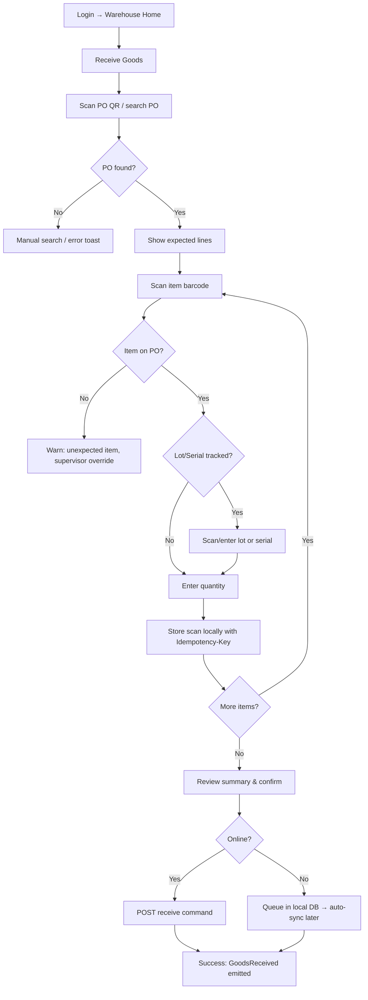
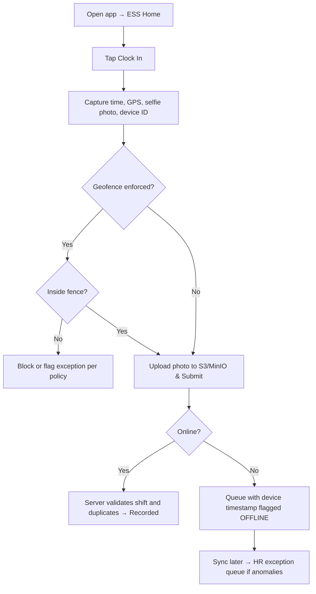
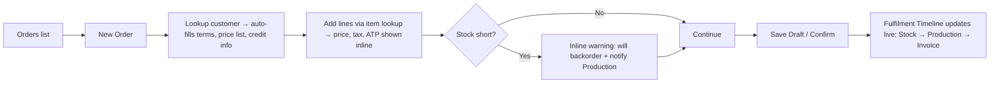

# OmniManage — UI/UX Design Specification

> **AI agent directive:** All UI code MUST follow this document. Use ONLY the design tokens, colors, motion rules, and component structures defined here. Never use default purple/indigo colors (#4f46e5) or hard-code hex colors directly in components. Every screen MUST implement the loading, empty, error, forbidden, and unlicensed states in §7.

---

## 1. Design Principles

| # | Principle | Practical Rule |
|---|---|---|
| P1 | **Data density with clarity** | ERP users work in tables all day. Offer Comfortable and Compact density. Use tabular numerals (`tabular-nums`) everywhere numbers are compared. |
| P2 | **Enterprise Color Discipline** | Strictly adhere to the custom 4-color palette (`#14D6E4`, `#8AFFC9`, `#4A3A3A`, `#C9DAD3`). Purge all default purple/indigo AI slop. |
| P3 | **Micro-Interactions & Motion** | State changes, modal triggers, and card hovers must feel tactile using 300ms transitions (`cubic-bezier`). |
| P4 | **Enter once, see everywhere** | Never ask for data the system already knows. Use pickers/lookups with inline "create new" instead of free text. Show linked records as navigable chips. |
| P5 | **Role-shaped experience** | A user sees only what they can use: menus and dashboards are filtered by licensed modules AND permissions. |
| P6 | **Predictable patterns** | The same list → detail → edit pattern in every module. Same placement of primary actions. |
| P7 | **Progressive disclosure** | Show essentials first and advanced fields in collapsible sections. |
| P8 | **Trust through feedback** | Every async action shows state (pending / success / failed). Financial actions show a confirmation and an audit link. |
| P9 | **Keyboard-first, mouse-friendly** | Command palette (`Ctrl/Cmd+K`), table navigation, form shortcuts. |
| P10 | **Accessible by default** | WCAG 2.2 AA. High contrast between Deep Charcoal (`#4A3A3A`) text and Soft Sage (`#C9DAD3`) borders. Never rely on color alone for status. |
| P11 | **Offline-tolerant mobile ESS** | Warehouse and attendance flows support offline queues with visual sync indicators. |

---

## 2. Design System

### 2.1 Stack
- **Next.js (App Router) + TypeScript + Tailwind CSS**
- **shadcn/ui** (Radix primitives) as the component base, copied into `src/components/ui`
- **TanStack Table** (data grids), **TanStack Query** (server state), **React Hook Form + Zod** (forms)
- **Recharts** (charts with `#14D6E4` glow gradients), **lucide-react** (icons), **date-fns** (dates), **sonner** (toasts)
- Flutter: **Material 3** with a custom `ThemeExtension` mirroring the web tokens.

### 2.2 Design Tokens (CSS variables, themable per tenant)

```css
/* src/styles/tokens.css */
:root {
  /* Brand Core Custom Palette */
  --color-teal-primary:   #14D6E4; /* Primary Actions, Active Highlights, Key Indicators */
  --color-mint-secondary: #8AFFC9; /* Success States, Active Toggles, Positive Badges */
  --color-charcoal-dark:  #4A3A3A; /* Dark Sidebars, Primary Text, Dark Cards, Headings */
  --color-sage-light:     #C9DAD3; /* Soft Slate/Sage Borders, Neutral Cards, Hover Surfaces */

  /* Mapped UI Tokens (Overriding default indigo) */
  --color-primary-50:     #E6FAFC;
  --color-primary-500:    #14D6E4;
  --color-primary-600:    #0EB8C4;
  --color-primary-700:    #0A8E98;

  --color-accent-mint:    #8AFFC9;

  /* Neutrals */
  --color-bg:             #F4F8F6;
  --color-surface:        #FFFFFF;
  --color-surface-dark:   #4A3A3A;
  --color-border:         #C9DAD3;
  --color-text:           #4A3A3A;
  --color-text-muted:     #6B7C75;

  /* Semantic Alerts */
  --color-success:        #8AFFC9;
  --color-warning:        #D97706;
  --color-danger:         #EF4444;
  --color-info:           #14D6E4;

  /* Shape & elevation */
  --radius-sm: 4px; --radius-md: 8px; --radius-lg: 12px;
  --shadow-sm: 0 1px 3px rgba(74, 58, 58, 0.08);
  --shadow-md: 0 4px 12px rgba(74, 58, 58, 0.12);

  /* Layout */
  --sidebar-w: 264px; --sidebar-w-collapsed: 72px; --topbar-h: 56px;
}

.dark {
  --color-bg:             #2D2323;
  --color-surface:        #3D3030;
  --color-border:         #5A4848;
  --color-text:           #F4F8F6;
  --color-text-muted:     #C9DAD3;
}


```

```ts
// tailwind.config.ts (excerpt)
export default {
  darkMode: ["class"],
  theme: {
    extend: {
      colors: {
        teal: { primary: "#14D6E4", hover: "#0EB8C4" },
        mint: { accent: "#8AFFC9" },
        charcoal: { DEFAULT: "#4A3A3A", light: "#6B7C75" },
        sage: { DEFAULT: "#C9DAD3", light: "#EAF1EE" },
        primary: { 50: "var(--color-primary-50)", 500: "var(--color-primary-500)", 600: "var(--color-primary-600)", 700: "var(--color-primary-700)" },
        surface: "var(--color-surface)", bg: "var(--color-bg)", border: "var(--color-border)",
        success: "var(--color-success)", warning: "var(--color-warning)", danger: "var(--color-danger)", info: "var(--color-info)",
      },
      fontFamily: { sans: ["Inter", "system-ui", "sans-serif"], mono: ["JetBrains Mono", "monospace"] },
      borderRadius: { sm: "var(--radius-sm)", md: "var(--radius-md)", lg: "var(--radius-lg)" },
    },
  },
};


```

### 2.3 Typography & Spacing

| Token | Size/Weight | Use |
| --- | --- | --- |
| `text-xs` | 12 / 400 | Table meta, helper text |
| `text-sm` | 14 / 400 | **Default body and table cells** |
| `text-base` | 16 / 500 | Form inputs (mobile ≥ 16 to prevent zoom) |
| `text-lg` | 18 / 600 | Card titles |
| `text-2xl` | 24 / 700 | Page titles |
| KPI | 32 / 700 | Dashboard KPI numbers |

* Font: **Inter**. Apply `font-variant-numeric: tabular-nums` (`tabular-nums` class) to ALL monetary/quantity columns. Numbers are right-aligned.
* Spacing is a **4px grid** (Tailwind default scale). Page padding is `p-6` (desktop) and `p-4` (mobile).

### 2.4 Motion & Micro-Animation Guidelines

| Animation Type | Target Component | Utility Class | Behavior |
| --- | --- | --- | --- |
| **Hover Float** | Metric Cards, Action Tiles | `transition-all duration-300 hover:-translate-y-1 hover:shadow-md` | Soft upward lift on cursor hover |
| **Glow Pulse** | Mobile ESS Clock-In Button | `animate-pulse ring-4 ring-[#14D6E4]/30` | Glowing pulse effect indicating active action |
| **Slide & Fade** | Modals, Drawers, Toasts | `transition-opacity duration-300 ease-in-out` | Smooth entrance from bottom or right edge |
| **Switch Toggle** | Module License Switch | `transition-transform duration-200 ease-spring` | Tactile spring slider changing background to `#8AFFC9` |
| **Sidebar Collapse** | Main App Shell Navigation | `transition-all duration-300 ease-in-out` | Smooth width adjustment (264px ↔ 72px) |
| **Chart Gradient Fill** | Recharts Area Graphs | LinearGradient `#14D6E4` opacity 0.4 → 0.0 | High-tech glowing aura under data curves |

### 2.5 Core Component Inventory (build once, reuse everywhere)

`AppShell`, `Sidebar`, `Topbar`, `PageHeader`, `DataTable` (server-side pagination/sort/filter/column-visibility/export), `FilterBar`, `FormSection`, `LookupSelect` (async search + inline create), `MoneyInput`, `QuantityInput`, `DateRangePicker`, `StatusBadge`, `ApprovalTimeline`, `AuditTimeline`, `FulfilmentTimeline`, `KpiCard`, `ChartCard`, `EmptyState`, `ErrorState`, `ForbiddenState`, `ModuleNotLicensedState`, `ConfirmDialog`, `CommandPalette`, `NotificationCenter`, `FileUploader`, `CameraCapture` (attendance selfies), `GanttChart` (projects), `QrScanner`, `DocumentViewer` (payslips/invoices).

### 2.6 Status Colors & Semantic Badges

| Semantic | Color Token | Text / Icon Color | Icon (required) | Example Usage |
| --- | --- | --- | --- | --- |
| Active / Optimal | `#8AFFC9` (Mint) | `#4A3A3A` | CheckCircle | Module Licensed, Healthy OEE, Verified Attendance |
| Primary Highlight | `#14D6E4` (Teal) | `#4A3A3A` | Activity / Zap | Live Sync, Active Shift, Primary Trigger |
| Warning / Pending | Amber `#FEF3C7` | Amber `#D97706` | AlertTriangle | Critical Stock Threshold, Awaiting Approval |
| Danger / Critical | Red `#FEE2E2` | Red `#EF4444` | XCircle | Reorder Alert, System Fault, Unauthorized Access |
| Neutral / Draft | `#C9DAD3` (Sage) | `#4A3A3A` | Circle | Draft Invoice, Idle Session, Archived Record |

### 2.7 Accessibility Rules

* Contrast ≥ 4.5:1 for text and ≥ 3:1 for UI components.
* Every interactive element is keyboard-reachable with a visible focus ring (`ring-2 ring-teal-primary`).
* Form fields have a `<label>`, an `aria-describedby` error and `aria-invalid`.
* Tables: use `<th scope>`, `aria-sort` and a caption or `aria-label`.
* Respect `prefers-reduced-motion`.

---

## 3. Layout Structures & Master Screen Specs

### 3.1 App Shell

```
┌──────────────────────────────────────────────────────────────────────────┐
│ TOPBAR (56px): [☰] Tenant Logo/Name | Breadcrumbs | ⌘K Search | 🔔 | 👤   │
├───────────────┬──────────────────────────────────────────────────────────┤
│ SIDEBAR       │ PAGE HEADER: Title · Status · [Secondary] [Primary CTA]  │
│ Background:   │──────────────────────────────────────────────────────────│
│ #4A3A3A       │ FILTER BAR / TABS                                        │
│ (264/72px)    │──────────────────────────────────────────────────────────│
│               │                                                          │
│ ▸ Executive BI│   CONTENT AREA (max-w-screen-2xl, scrolls independently) │
│ ▸ HRIS        │   Background: #F4F8F6                                    │
│ ▸ Projects    │   Cards: #FFFFFF with #C9DAD3 Borders                    │
│ ▸ Finance     │                                                          │
│ ▸ Supply Chain│                                                          │
│ ▸ CRM/Sales   │                                                          │
│ ▸ Assets      │                                                          │
│ ...           │                                                          │
│ ─────────     │                                                          │
│ ⚙ Settings    │                                                          │
└───────────────┴──────────────────────────────────────────────────────────┘


```

* Sidebar background uses Deep Charcoal (`#4A3A3A`). It collapses to an icon rail (72px) at `< 1280px` and becomes an off-canvas drawer at `< 768px`.
* Active sidebar items feature a Teal border indicator (`#14D6E4`) and a Mint highlight badge (`#8AFFC9`).
* The topbar shows the current tenant; the Superadmin console uses a distinct accent bar (amber) to avoid confusion with tenant context.

### 3.2 Dynamic Sidebar

**Source of truth:** the login/session payload. The frontend keeps a **static navigation registry** keyed by `module_code`. At render time it filters by (a) `activeModules` AND (b) the user's `permissions`.

> Client-side filtering is a UX convenience ONLY. The backend always re-enforces module and permission checks (see `Security.md`).

```jsonc
// POST /api/v1/auth/login → data (excerpt)
{
  "user": { "id": "…", "displayName": "Rina Putri", "roles": ["SALES_REP"] },
  "tenant": { "id": "…", "name": "PT Contoh Jaya", "branding": { "primary": "#14D6E4", "logoUrl": "…" } },
  "activeModules": ["PLATFORM_CORE", "CORE_MASTERDATA", "SALES_CORE", "CRM_CORE", "INV_CORE", "FIN_AR", "FIN_GL"],
  "permissions": ["sales.order.read", "sales.order.create", "sales.order.confirm", "crm.lead.read"]
}


```

```ts
// src/config/navigation.registry.ts
import type { LucideIcon } from "lucide-react";
import { ShoppingCart, Boxes, Wallet, Users, Factory, ShieldCheck, Truck, ChartBar, Briefcase, QrCode } from "lucide-react";

export interface NavItem {
  id: string;
  labelKey: string;          // i18n key
  href?: string;
  icon?: LucideIcon;
  moduleCode: string;        // required licensed module
  permission?: string;       // required permission (any-of if array)
  children?: NavItem[];
}

export const NAVIGATION_REGISTRY: NavItem[] = [
  { id: "bi", labelKey: "nav.bi", icon: ChartBar, href: "/dashboard", moduleCode: "PLATFORM_CORE" },
  { id: "hris", labelKey: "nav.hris", icon: Users, href: "/hris", moduleCode: "HRIS_CORE" },
  { id: "projects", labelKey: "nav.projects", icon: Briefcase, href: "/projects", moduleCode: "PROJECT_CORE" },
  { id: "finance", labelKey: "nav.finance", icon: Wallet, href: "/finance", moduleCode: "FIN_GL" },
  { id: "inventory", labelKey: "nav.inventory", icon: Boxes, href: "/inventory", moduleCode: "INV_CORE" },
  { id: "sales", labelKey: "nav.sales", icon: ShoppingCart, href: "/sales", moduleCode: "SALES_CORE" },
  { id: "manufacturing", labelKey: "nav.manufacturing", icon: Factory, href: "/manufacturing", moduleCode: "MFG_CORE" },
  { id: "procurement", labelKey: "nav.procurement", icon: Truck, href: "/procurement", moduleCode: "PROC_CORE" },
  { id: "assets", labelKey: "nav.assets", icon: QrCode, href: "/assets", moduleCode: "ASSET_CORE" },
  { id: "security", labelKey: "nav.security", icon: ShieldCheck, href: "/admin/security", moduleCode: "PLATFORM_CORE" },
];


```

```ts
// src/lib/navigation/buildSidebar.ts
export function buildSidebar(registry: NavItem[], active: Set<string>, perms: Set<string>): NavItem[] {
  const visible = (i: NavItem) => active.has(i.moduleCode) && (!i.permission || perms.has(i.permission));
  return registry
    .filter(visible)
    .map(i => ({ ...i, children: i.children ? buildSidebar(i.children, active, perms) : undefined }))
    .filter(i => !i.children || i.children.length > 0 || i.href);   // drop empty parents
}


```

**Sidebar rules**

1. Hidden, never disabled: unlicensed or unauthorized items are NOT rendered (no teasers). Exception: the Tenant Admin sees a subtle "Available modules" link that opens a contact-sales dialog.
2. Active module changes are picked up on `GET /auth/session` (called on app focus, every 5 min, and after any `403 MODULE_NOT_LICENSED`). The sidebar re-renders without a full reload.
3. Deep link to an unlicensed route renders `ModuleNotLicensedState` (not a generic 404).
4. Max 2 nesting levels. Section order follows the business flow: Dashboard → HRIS → Projects → CRM → Sales → Inventory → Procurement → Manufacturing → Finance → Assets → Settings.
5. Persist collapsed/expanded state per user in `localStorage` (UI preference only, never data).

### 3.3 Dashboard

**Role-based dashboards.** One `DashboardGrid` (12-col) hosts widgets registered by module. Each widget declares `moduleCode` and `permission` and renders only if both are satisfied. Widgets for OFF modules do NOT fire their queries.

```
CEO / Tenant Admin Dashboard
┌──────────┬──────────┬──────────┬──────────┐
│ Revenue  │ Open A/R │ Stock    │ Headcount│   ← KpiCard row (live, ▲▼ vs prior period)
│ MTD      │ + Aging  │ Value    │ + Present│
├──────────┴──────────┼──────────┴──────────┤
│ Sales vs Target     │ Cash Flow (30d)     │   ← ChartCard (#14D6E4 glow area)
│ (line/bar)          │ (area)              │
├─────────────────────┼─────────────────────┤
│ Production Status   │ Low Stock / MRP     │
│ (progress bars)     │ Shortages (table)   │
├─────────────────────┴─────────────────────┤
│ Live Activity Feed (SalesOrderConfirmed…) │
└───────────────────────────────────────────┘


```

* **Real-time:** the client subscribes to a SignalR hub group `tenant:{tenantId}:dashboard`. Events patch the TanStack Query cache. A subtle "Live" indicator shows connection status, with automatic fallback to 30 s polling when the socket is down.
* Each KPI card is clickable, drilling down to the filtered list.

| Role | Home Dashboard Focus |
| --- | --- |
| Tenant Admin / CEO | Cross-module KPIs, live activity feed |
| HR Manager | Headcount, attendance exceptions, pending leave approvals, payroll status |
| Project Manager | Project timelines, team workload, KPI generator metrics, task completion rates |
| Finance Manager | A/R & A/P aging, approvals queue, cash position, unposted documents |
| Sales Rep | My pipeline, my open orders, targets |
| Warehouse Operator | Today's receipts/picks, low stock, discrepancies |
| Production Manager | MRP shortages, work-order status (Phase 2), material availability |
| General Staff | Clock-in card, leave balance, latest payslip, announcements |
| Superadmin | Tenants, module adoption, system health, billing |

### 3.4 Module Management Console (Superadmin)

```
Superadmin Console › Tenants › PT Contoh Jaya › Modules
┌───────────────────────────────────────────────────────────────────────┐
│ Plan: Business  ·  Status: Active   [Suspend Tenant]                  │
├───────────────────────────────────────────────────────────────────────┤
│ FINANCE                                                               │
│  [●] FIN_GL    General Ledger                       since 2026-01-04  │
│  [●] FIN_AR    Accounts Receivable     requires FIN_GL                │
│  [○] FIN_AP    Accounts Payable        requires FIN_GL                │
│ HRIS                                                                  │
│  [●] HRIS_CORE      [●] HRIS_ATTENDANCE      [○] HRIS_PAYROLL         │
│ …                                                                     │
├───────────────────────────────────────────────────────────────────────┤
│ Pending changes: 1  ·  [Review & Apply]                               │
└───────────────────────────────────────────────────────────────────────┘


```

* The toggle is a `Switch` with a text label (ON/OFF) so it does not depend on color. Active state background switches to Mint (`#8AFFC9`).
* **Dependency handling:** toggling ON a module whose dependency is OFF opens a dialog "Also enable FIN_GL?". Toggling OFF a depended-upon module is blocked, with the dependents listed.
* **Disable confirmation:** a `ConfirmDialog` with an impact summary ("12 active users, 340 records will become inaccessible. Data is retained.") and a required reason field (stored in the audit log).
* Optimistic UI is NOT used for licensing changes. Wait for server confirmation.
* Optional `expires_at` (trial/term licenses) shown as a date chip.

### 3.5 Detailed Master Views (12 Google Stitch Screens)

1. **Executive BI & Corporate Performance (`/dashboard`)**: KPI cards (Total Net Revenue, Operating Margin, Headcount, Cashflow Runways), Cash Flow & Revenue Trajectory Area Chart (`#14D6E4` glow), Module Allocation list, Executive Pulse & Anomaly Detection log.
2. **HRIS & People Operations Control (`/hris`)**: Active FTE stats, Smart Attendance tracking (GPS + Selfie logs), Leave & WFH Authorization cards, Kasbon Deduction manager, Payroll Calculation Engine dispatcher, Paginated Employee Master Directory.
3. **Finance & Accounts Management (`/finance`)**: AR/AP metrics, Live Invoice Configuration Engine, Cryptographically Signed E-Invoice preview, Settlement Audit Ledger, Payroll GL Integration log.
4. **Supply Chain & Multi-Warehouse Logistics (`/inventory`)**: SKU Valuation stats, Material Requirement Planning (MRP) table with `Trigger PO` actions, Depot Bin Velocity Heatmap, Live Stock Telemetry Stream.
5. **CRM & Enterprise Sales Pipeline (`/sales`)**: Total Pipeline Value metrics, Stage Execution Kanban Board (`Qualified Leads` → `Proposal` → `Legal` → `Closed Won`), Live Order Auto-Deduct Preview, Top Accounts Revenue Ledger.
6. **Mobile ESS Kiosk / Shift Portal (`/mobile/ess`)**: 375px mobile frame, Real-time clock header, Large animated **Tap to Clock Out / Clock In** pulse button (`#14D6E4`) triggering camera for selfie, Quick Action Grid (`Request PTO`, `Payslip`, `Claim Expense`), Recent Timesheet Activity log.
7. **Superadmin Module Licensing & Tenant Control (`/admin/licensing`)**: Tenant Directory, Dynamic Module License Matrix with `#8AFFC9` toggle switches per tenant, Provisioning Delta & SLA Commitment box, Database Isolation Health metrics.
8. **MES & Industrial Production Control (`/manufacturing`)**: Overall Equipment Effectiveness (OEE) gauge, Real-Time Shop Floor Cell Status, Multi-Level BOM Explosion Tree & Allocation, Active Work Order Dispatch Queue.
9. **Procurement, Vendor Relations & PO Management (`/procurement`)**: Requisition Multi-Level Workflow Engine (Tier 1 <50M, Tier 2 50K-250K, Tier 3 >250K), RFQ Quote Comparison Matrix, Strategic Vendor Scorecards, Active PO Execution Ledger.
10. **Governance, Immutable Audit Trail & RBAC Matrix (`/admin/security`)**: Cryptographic Immutable Audit Trail with Merkle-tree hash signatures, RBAC Security Permission Grid, Live Active User Sessions with instant `Terminate` actions, Infrastructure & KMS Integrity status.
11. **Project & Task Management (`/projects`)**: Gantt chart timeline view, Team Workload Kanban, Automated KPI Generator reports, Work Log tracking, and Budget vs Actual project ledger.
12. **Asset Maintenance & Registry (`/assets`)**: Asset directory, QR Code label generator, Depreciation schedule hooks to GL, Corrective & Preventive Maintenance dispatch board.

---

## 4. Standard Screen Patterns

### 4.1 List Screen

`PageHeader` (title, primary CTA) → `FilterBar` (search, status chips, saved views) → `DataTable` → pagination. Row click opens detail. Bulk actions appear in a sticky bar when rows are selected. Always provide Export (CSV/XLSX/PDF) if `*.export` permission is held.

### 4.2 Detail Screen

Header (document number, status badge, key actions) → tabs: **Overview · Lines · Related · Timeline · Audit**. The *Related* tab lists linked cross-module documents (e.g., SO → Delivery → Invoice → Journal) as clickable chips. This is the visible proof of "zero double entry".

### 4.3 Form Screen

Single column for ≤ 8 fields. Two-column grid for more. Sticky footer with Save / Save & Continue / Cancel. Validation: inline on blur, summary on submit. Unsaved-changes guard on navigation. Document totals recalculate live, using the shared money utilities.

### 4.4 Approval UX

`ApprovalTimeline` shows steps, approvers, status and comments. Approvers act via Approve / Reject (reason required for reject) from detail pages AND from a consolidated **My Approvals** inbox.

---

## 5. Mobile vs. Web Specific Flows

### 5.1 Platform Responsibility Matrix

| Capability | Web (Next.js) | Mobile (Flutter) |
| --- | --- | --- |
| Admin consoles, configuration, reports | ✅ Full | ❌ |
| Dashboards | ✅ Full | ◐ Read-only KPI summary (CEO/Sales) |
| Sales orders, CRM | ✅ Full | ◐ Lookup, status, quick lead capture |
| Approvals | ✅ | ✅ Push-driven approve/reject |
| **Smart Attendance (GPS & Selfie)** | ✅ | ✅ **Primary** |
| **Employee Self-Service** (leave, payslip) | ✅ | ✅ **Primary** |
| **Warehouse** (receive, put-away, pick, count) | ✅ | ✅ **Primary** (barcode scan) |
| **Asset QR Scanning** | ❌ | ✅ **Primary** |
| Offline operation | ❌ | ✅ (Warehouse + clock-in) |

### 5.2 Mobile Design Rules

* Bottom navigation (max 5 tabs) determined by role and active modules (same session payload, same filtering logic as the web sidebar).
* Touch targets ≥ 48×48 dp. Primary action reachable by thumb (bottom-anchored).
* Camera and Location permissions are required for Smart Attendance. QR/Barcode scanning utilizes `mobile_scanner`. Hardware scanners (keyboard-wedge/Zebra DataWedge) must be supported.
* High-contrast "warehouse mode" theme (large type, strong colors) for glare conditions.
* Biometric gate (fingerprint/Face ID) for payslips and when resuming after 5 min of inactivity.
* Sync status chip in the app bar: `Synced · Syncing · N pending · Error`.

### 5.3 Flow: Warehouse Receiving (Mobile)



### 5.4 Flow: Employee Clock-In (Mobile/Web ESS)



### 5.5 Flow: Sales Order Creation (Web)



### 5.6 Offline & Sync UX (Mobile)

* Local store (SQLite) holds a **command queue**. Each command carries `Idempotency-Key` (UUIDv7), `createdAtDevice` and `payload`.
* Conflict policy: server wins for master data. Transactions are append-only (scan events), so they do not conflict. Rejected commands appear in a "Needs attention" list with a human-readable reason.

---

## 6. Content & Interaction Guidelines

* **Language:** concise, action-oriented labels ("Confirm Order", not "Submit"). All strings come from i18n files (`en`, plus locale files). No hard-coded strings.
* **Money:** always show currency code on multi-currency screens. Format via `Intl.NumberFormat`. Store as `decimal`, transmit as string in JSON (`"1250000.00"`), never as float.
* **Dates:** display in the user's timezone, store and transmit in UTC ISO-8601.
* **Destructive actions:** always `ConfirmDialog`, naming the object. Prefer Cancel/Void over Delete for posted documents.
* **Toasts:** success 4 s, error persists until dismissed (include `traceId` copy button for support).
* **Numbers in tables:** right-aligned, tabular, negative values in parentheses or with a minus sign and danger color plus sign (not color alone).

## 7. Required UI States (every screen)

| State | Component | Visual Specification |
| --- | --- | --- |
| **Loading** | Skeleton Loader | Light sage (`#EAF1EE`) animated pulsing blocks matching exact card layout |
| **Empty** | `EmptyState` | Charcoal icon, clear explanatory text, primary `#14D6E4` CTA button |
| **Error** | `ErrorState` | Message + Retry button + copyable `traceId` |
| **Forbidden (403 permission)** | `ForbiddenState` | Shield icon, "You don't have access", contact admin CTA |
| **Module not licensed (403 `MODULE_NOT_LICENSED`)** | `ModuleNotLicensedState` | Lock icon, explain the module is not active for the company. Tenant Admin sees contact-sales CTA |
| **Offline (web/mobile)** | `OfflineBanner` | Top sticky banner showing queued commands with sync status |

---

## 8. Frontend Folder Conventions

```
frontend/
├── src/
│   ├── app/                      # Next.js App Router (route groups per module)
│   │   ├── (auth)/login/page.tsx
│   │   ├── (app)/dashboard/page.tsx
│   │   ├── (app)/hris/page.tsx
│   │   ├── (app)/projects/page.tsx
│   │   ├── (app)/finance/page.tsx
│   │   ├── (app)/inventory/page.tsx
│   │   ├── (app)/sales/page.tsx
│   │   ├── (app)/manufacturing/page.tsx
│   │   ├── (app)/procurement/page.tsx
│   │   ├── (app)/assets/page.tsx
│   │   ├── (app)/admin/licensing/page.tsx
│   │   └── (app)/admin/security/page.tsx
│   ├── components/
│   │   ├── ui/                   # shadcn primitives
│   │   ├── shared/               # DataTable, LookupSelect, KpiCard, StatusBadge, DynamicSidebar
│   │   └── modules/              # Specific module widgets (InvoiceEngine, BOMTree)
│   ├── features/<module>/        # components, hooks, api, schemas, types per module (e.g., projects, assets)
│   ├── config/navigation.registry.ts
│   ├── lib/{api,auth,i18n,navigation,utils}
│   └── styles/tokens.css


```

```

```