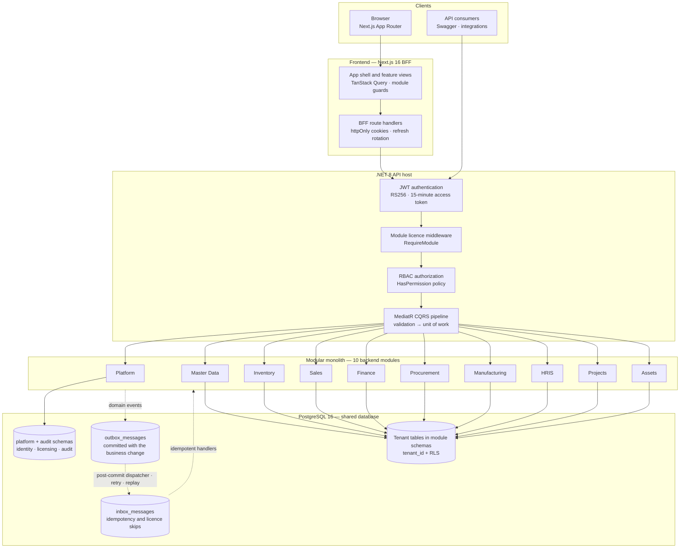
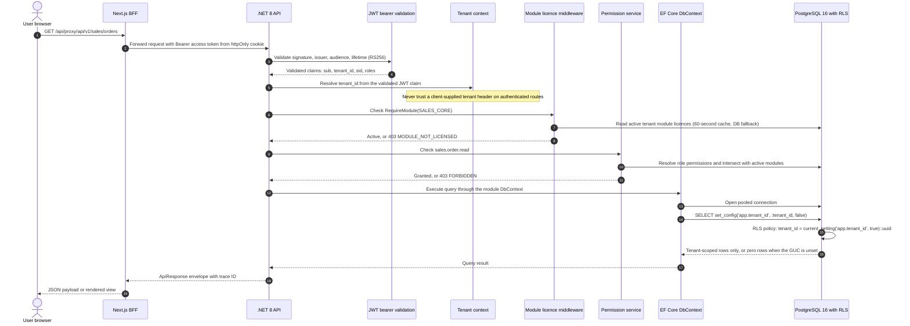

# OmniManage ERP — Enterprise Resource Planning Monolith

[](https://dotnet.microsoft.com/)
[](https://nextjs.org/)
[](https://www.typescriptlang.org/)
[](https://www.postgresql.org/)
[](https://tailwindcss.com/)
[](https://www.docker.com/)

[](#verification--quality-gates-baseline)
[](#verification--quality-gates-baseline)
[](#complete-application-route-registry)

**A modular-monolith ERP for multi-tenant operations.** OmniManage combines a .NET 8
API, a Next.js 16 BFF frontend, PostgreSQL 16 row-level security, runtime module
licensing, and event-driven module integration in one deployable system.

> **Status:** All 10 delivery phases are complete. Phase 10 baseline: 10 backend
> modules, 154 frontend tests, and 27 active Next.js routes.

| At a glance | |
| --- | --- |
| **Architecture** | Modular monolith — one API host, 10 bounded modules, contract-only cross-module calls |
| **Tenancy** | Shared database, schema per module, `tenant_id` on every business table, PostgreSQL RLS |
| **API** | .NET 8 · ASP.NET Core · MediatR CQRS · FluentValidation · Swagger |
| **Web** | Next.js 16 App Router · React 19 · TypeScript · TanStack Query · Tailwind CSS |
| **Identity** | JWT RS256 access tokens · rotating refresh tokens · BFF httpOnly cookies |
| **Authorization** | RBAC permission codes intersected with active module licences |
| **Integration** | Transactional outbox/inbox · post-commit dispatch · idempotent, licence-aware consumers |
| **Quality baseline** | Release build 0 errors / 0 warnings · 154/154 Vitest tests · 27 emitted routes |

**Jump to:** [Executive Summary](#executive-summary--core-philosophy) ·
[Architecture](#architecture--data-flow) · [Tech Stack](#comprehensive-tech-stack-table) ·
[Directory Layout](#project-directory-structure) · [Module Matrix](#enterprise-module-capability-matrix) ·
[Security](#multi-tenancy--security-architecture) · [Quickstart](#developer-quickstart--local-setup) ·
[Quality Gates](#verification--quality-gates-baseline) · [Routes](#complete-application-route-registry)

---

## Executive Summary & Core Philosophy

OmniManage is an enterprise resource planning system built as a **modular monolith**,
not a premature distribution of microservices. One .NET 8 host composes ten business
modules behind a single HTTP pipeline, while each module keeps its own domain model,
application handlers, persistence schema, migrations history, and presentation layer.
The boundaries are enforced in code and in tests: modules may reference another
module's `Contracts` project, never its domain or infrastructure.

The defining architectural choices are deliberate:

- **Tenant isolation is enforced twice.** EF Core global query filters provide the
  application-level guard; PostgreSQL Row-Level Security provides the database-level
  guard. The runtime role is a non-owner with `NOBYPASSRLS`, and an unset tenant GUC
  fails closed to zero rows.
- **Licensing is part of authorization.** A permission is effective only when its
  owning module is active for the tenant. Disabling `INV_CORE` does not merely hide a
  menu item; it removes the permission at the policy layer and causes event consumers
  to record an explicit `SKIPPED_MODULE_DISABLED` outcome.
- **The browser never holds a token.** The Next.js BFF exchanges credentials, stores
  JWTs in `httpOnly` cookies, rotates refresh tokens, and proxies API traffic. There is
  no token in `localStorage` or JavaScript-readable state.
- **Modules collaborate through events, not shared tables.** Cross-module references
  are GUIDs plus denormalized snapshots. Business changes and outbox rows commit in the
  same transaction; consumers use an inbox for idempotency and licence-aware skipping.
- **Operational safety is a first-class feature.** Migrations are forward-only, posted
  financial records are immutable, audit rows are hash-chained, and destructive reset is
  an explicit, interactive action.

### Documentation map

| Document | Purpose |
| --- | --- |
| [Architecture.md](Architecture.md) | System context, module boundaries, tenancy, licensing, event catalogue, ADRs |
| [Security.md](Security.md) | Threat model, JWT specification, RBAC matrix, audit and infrastructure controls |
| [DESIGN.md](DESIGN.md) | Design system, navigation, screen patterns, responsive and accessibility rules |
| [PRD.md](PRD.md) | Product scope, use cases, delivery phases and acceptance criteria |
| [Rules.md](Rules.md) | Coding, testing, review and quality rules |
| [docs/api-contract-audit.md](docs/api-contract-audit.md) | Endpoint, BFF and contract audit |
| [docs/error-codes.md](docs/error-codes.md) | Canonical error-code catalogue |

---

## Architecture & Data Flow

### 1. Modular monolith runtime topology

The API host owns authentication, module-licence enforcement, authorization, the
MediatR pipeline, and module registration. Each module owns its schema and its
`DbContext`; the platform module owns identity, tenancy, licensing and the audit trail.



**Boundary rules enforced by the build and architecture tests**

| Rule | Enforcement |
| --- | --- |
| A module may reference another module only through `*.Contracts` | Project references and `NetArchTest` architecture tests |
| No shared `DbContext` across modules | One `DbContext` per module, one schema per module |
| No cross-schema foreign keys except `platform.tenants` | Schema and migration review; GUID references across modules |
| Every business table is tenant-scoped | `ITenantEntity`, global query filter, `EnableTenantRls` migration helper |
| Every endpoint is authenticated or explicitly anonymous | Global fallback authorization policy plus `[AllowAnonymous]` |
| Every licensed endpoint declares its module | `[RequireModule(ModuleCodes.*)]` metadata and `ModuleLicenseMiddleware` |

### 2. Multi-tenant request execution flow

A request is authenticated once, resolved to a tenant once, checked against the
tenant's active licences, authorized against the effective permission set, and then
executed on a database connection whose session GUC is set before any query runs.



**Request-path invariants**

1. `tenant_id` comes from the validated JWT, never from a caller-controlled header on
   an authenticated endpoint.
2. The licence check happens before the permission check: a permission from a disabled
   module is not effective.
3. `PermissionService` resolves the permission code to its owning module, verifies the
   licence, then checks the user's role-derived permission codes.
4. The connection interceptor sets `app.tenant_id` on every opened pooled connection;
   RLS applies to every tenant table on that connection.
5. A missing tenant GUC makes `current_setting('app.tenant_id', true)` return `NULL`,
   so the policy predicate is false and the query returns zero rows.

### 3. Asynchronous integration and module decoupling

Cross-module state changes use integration events. The producer commits the business
change and the outbox row in the same `SaveChanges` transaction; the post-commit
dispatcher invokes registered consumers. A failed dispatch leaves the outbox row
unprocessed for replay rather than failing a request whose business change already
committed. Consumers check the inbox first, so redelivery is idempotent.

| Integration flow | Producer | Implemented consumers | Licence guard |
| --- | --- | --- | --- |
| `SalesOrderConfirmed` | Sales | Inventory deducts stock; Finance posts the A/R invoice and balanced GL journal | `INV_CORE`; `FIN_AR` + `FIN_GL` |
| `PayrollFinalized` | HRIS | Finance posts the payroll journal (expense, cash/bank, tax payable, deductions payable) | `FIN_GL` |
| `AssetMaintenanceRequested` | Assets | Finance records the maintenance tracking reference; no journal until cost is confirmed | `FIN_GL` |

Additional event contracts are published for future consumers, including
`SmartAttendanceClockedIn`, `TaskCompleted`, and `ArInvoicePosted`. When a consumer's
required module is inactive, the inbox records `SKIPPED_MODULE_DISABLED` and the
producer's transaction remains successful.

---

## Comprehensive Tech Stack Table

| Category | Technology | Version | Role / purpose |
| --- | --- | --- | --- |
| **Backend** | .NET / ASP.NET Core / C# | 8.0 · C# 12 | API host, controllers, DI, middleware and module composition |
| **Backend** | MediatR | 12.5.0 | CQRS command/query dispatch and pipeline behaviors |
| **Backend** | FluentValidation | 11.9.2 | Request and command validation before handlers |
| **Backend** | Entity Framework Core | 8.0.32 | Per-module persistence, migrations and query filters |
| **Backend** | Npgsql EF Core provider | 8.0.11 | PostgreSQL 16 provider, pooling and connection interception |
| **Backend** | Serilog.AspNetCore | 8.0.3 | Structured request and application logging |
| **Backend** | Swashbuckle.AspNetCore | 8.1.4 | OpenAPI generation and Swagger UI in Development |
| **Backend** | Argon2 (Konscious) | 1.3.1 | Argon2id password hashing (64 MiB, 3 iterations, parallelism 2) |
| **Backend** | xUnit · NetArchTest | 2.9.3 · 1.3.2 | Unit, integration and architecture-boundary tests |
| **Frontend** | Next.js | 16.4.2 | App Router, route handlers, BFF and production build |
| **Frontend** | React | 19.3.1 | Server and client components |
| **Frontend** | TypeScript | 5.9.3 | Strict application and API-contract typing |
| **Frontend** | Tailwind CSS | 3.4.19 | Design tokens, responsive layout and component styling |
| **Frontend** | TanStack Query | 5.104.5 | Server-state caching, mutations and invalidation |
| **Frontend** | React Hook Form · Zod | 7.90.0 · 4.6.7 | Form state and schema validation |
| **Frontend** | Recharts · Lucide | 3.10.1 · 1.61.0 | Dashboard charts and icon system |
| **Frontend** | Vitest · Testing Library | 3.2.7 · 16.3.3 | Component, hook and utility tests in JSDOM |
| **Database** | PostgreSQL | 16 (`postgres:16`) | Shared multi-tenant database, module schemas and RLS |
| **Database** | Row-Level Security | PostgreSQL native | Fail-closed tenant isolation on every tenant table |
| **Infrastructure** | Docker Compose | Compose v2 | Local PostgreSQL 16 on host port `5433` |
| **Infrastructure** | PowerShell / `run.ps1` | Windows PowerShell 5.1+ | Single local automation entry point |
| **Infrastructure** | Node.js / npm | 20.9+ | Frontend toolchain and development server |
| **Infrastructure** | .NET SDK / `dotnet-ef` | 8.0.4xx / 8.0.x | Build, run and forward-only migration application |

Package versions are centrally managed in
[`backend/Directory.Packages.props`](backend/Directory.Packages.props); the frontend
uses a committed `package-lock.json`.

---

## Project Directory Structure

```text
OmniManage/
├── backend/
│   ├── OmniManage.sln                 # 63 projects: 55 production + 8 test projects
│   ├── Directory.Build.props          # net8.0, nullable, analyzers, warnings as errors
│   ├── Directory.Packages.props       # central NuGet version management
│   ├── src/
│   │   ├── BuildingBlocks/
│   │   │   ├── OmniManage.BuildingBlocks.Application/      # CQRS, tenancy, audit abstractions
│   │   │   ├── OmniManage.BuildingBlocks.Contracts/        # module codes, permissions, API envelope
│   │   │   ├── OmniManage.BuildingBlocks.Domain/           # entities, results, domain events
│   │   │   └── OmniManage.BuildingBlocks.Infrastructure/   # EF Core, RLS, outbox/inbox, storage, export
│   │   ├── Host/
│   │   │   └── OmniManage.Api/
│   │   │       ├── Authentication/    # JWT bearer configuration and development signing key
│   │   │       ├── Middleware/        # exception, response envelope, module licence
│   │   │       ├── Seeding/           # idempotent demo tenant and module seeders
│   │   │       └── Tenancy/           # HTTP tenant, user and audit context adapters
│   │   └── Modules/
│   │       ├── Platform/              # identity, tenancy, licensing, authorization, audit
│   │       ├── MasterData/            # business partners, items
│   │       ├── Inventory/             # warehouses, stock ledger, balances, adjustments
│   │       ├── Sales/                 # sales orders, confirmation and outbox
│   │       ├── Finance/               # chart of accounts, journals, A/R invoices
│   │       ├── Procurement/           # suppliers, purchase orders
│   │       ├── Manufacturing/         # bills of materials, work orders
│   │       ├── Hris/                  # employees, smart attendance, payroll
│   │       ├── Projects/              # projects, tasks, work logs
│   │       └── AssetMaintenance/      # asset register, maintenance orders
│   └── tests/
│       ├── OmniManage.Architecture.Tests/
│       ├── OmniManage.Api.IntegrationTests/
│       ├── OmniManage.BuildingBlocks.UnitTests/
│       └── OmniManage.Modules.*.UnitTests/                 # Finance, Inventory, MasterData, Platform, Sales
├── frontend/
│   ├── src/
│   │   ├── app/                       # App Router: (app), (auth), api/auth/*, api/proxy/[...path]
│   │   ├── components/                # ui primitives, shared states, shell, providers
│   │   ├── config/                    # module codes, permissions, roles, navigation, labels
│   │   ├── features/                  # feature-first views, hooks, API keys and tests
│   │   ├── lib/                       # API client, BFF helpers, auth, i18n, formatting
│   │   └── test/                      # Vitest setup and test utilities
│   ├── package.json
│   ├── next.config.ts
│   ├── tailwind.config.ts
│   └── vitest.config.ts
├── docs/
│   ├── api-contract-audit.md          # endpoint, BFF and contract audit
│   └── error-codes.md                 # canonical error-code catalogue
├── infra/
│   └── postgres/init/
│       └── 001-roles-and-schemas.sql  # runtime roles, schemas and privileges
├── docker-compose.yml                 # local PostgreSQL 16
├── run.ps1                            # infra, migrate, backend, frontend, all, reset, status
├── Architecture.md
├── Security.md
├── DESIGN.md
├── PRD.md
├── Rules.md
└── README.md
```

Each module follows the same five-project anatomy:

```text
backend/src/Modules/Sales/
├── OmniManage.Modules.Sales.Domain/           # entities, value objects, domain events, errors
├── OmniManage.Modules.Sales.Application/      # commands, queries, handlers, validators, event handlers
├── OmniManage.Modules.Sales.Infrastructure/   # DbContext, configurations, repositories, outbox/inbox
├── OmniManage.Modules.Sales.Presentation/     # controllers and request/response models
└── OmniManage.Modules.Sales.Contracts/        # integration events and cross-module read contracts
```

> **Automation note:** there is no `scripts/` directory in this repository.
> `run.ps1` is the single local automation entry point; keep it that way unless a workflow
> cannot be expressed there.

---

## Enterprise Module Capability Matrix

| Module | Module code(s) | Key capabilities | Primary permissions | Assigned system roles |
| --- | --- | --- | --- | --- |
| **Platform** | `PLATFORM_CORE` | Tenant lifecycle, JWT login/refresh/logout, session introspection, RBAC, dynamic module licensing, audit trail | Role-gated admin APIs; no business permission code | `TENANT_ADMIN`, `SYSTEM_SUPERADMIN` (platform realm) |
| **Master Data** | `CORE_MASTERDATA` | Business partners (customer/vendor), tax IDs and credit limits, items/SKUs, UoM codes, pricing and cost | `masterdata.business_partner.read`<br/>`masterdata.business_partner.create`<br/>`masterdata.item.read`<br/>`masterdata.item.create` | `TENANT_ADMIN`, `FINANCE_MANAGER`, `SALES_REPRESENTATIVE`, `PROJECT_MANAGER`, `WAREHOUSE_OPERATOR`, `GENERAL_STAFF` |
| **Inventory** | `INV_CORE` | Warehouses, stock ledger, stock balances, stock adjustments, sales-confirmation stock deduction consumer | `inventory.warehouse.read`<br/>`inventory.warehouse.create`<br/>`inventory.stock.read`<br/>`inventory.stock.adjust` | `TENANT_ADMIN`, `WAREHOUSE_OPERATOR`, `PRODUCTION_MANAGER`; read: `SALES_REPRESENTATIVE`, `FINANCE_MANAGER` |
| **Sales** | `SALES_CORE`<br/>`CRM_CORE`* | Sales order draft/create/confirm, customer snapshots, order totals, confirmation event to inventory and finance | `sales.order.read`<br/>`sales.order.create`<br/>`sales.order.confirm`<br/>`crm.lead.read`<br/>`crm.customer.read_all` | `SALES_REPRESENTATIVE`, `TENANT_ADMIN`; read: `FINANCE_MANAGER`, `WAREHOUSE_OPERATOR`, `PRODUCTION_MANAGER` |
| **Finance** | `FIN_GL`<br/>`FIN_AR`<br/>`FIN_AP`* | Chart of accounts, append-only journal entries, A/R invoices, sales/payroll/asset event posting | `finance.journal.read`<br/>`finance.invoice.read`<br/>`finance.invoice.approve`<br/>`finance.payment.approve` | `FINANCE_MANAGER`, `TENANT_ADMIN`; journal read: `HR_MANAGER`; own-customer invoices: `SALES_REPRESENTATIVE` |
| **Procurement** | `PROC_CORE` | Supplier directory, payment terms and contact data, purchase orders and line pricing | `procurement.supplier.read`<br/>`procurement.purchase_order.read`<br/>`procurement.purchase_order.create` | `TENANT_ADMIN`, `PRODUCTION_MANAGER`; read/approve: `FINANCE_MANAGER`; receiving read: `WAREHOUSE_OPERATOR` |
| **Manufacturing** | `MFG_CORE` | Bills of materials with components and versions, work orders, order status lifecycle, inventory material issue dependency | `manufacturing.bill_of_material.read`<br/>`manufacturing.work_order.read`<br/>`manufacturing.work_order.create` | `PRODUCTION_MANAGER`, `TENANT_ADMIN`; read: `WAREHOUSE_OPERATOR` |
| **HRIS** | `HRIS_CORE`<br/>`HRIS_ATTENDANCE`<br/>`HRIS_PAYROLL`<br/>`HRIS_ESS` | Employee master, GPS/selfie smart attendance, payroll runs and finalization, employee self-service shell | `hris.employee.view_sensitive`<br/>`hris.attendance.read`<br/>`hris.attendance.clock_in`<br/>`hris.payroll.approve` | `HR_MANAGER`, `TENANT_ADMIN`; team read: `PROJECT_MANAGER`; self-service: `GENERAL_STAFF`; payroll journal: `FINANCE_MANAGER` |
| **Projects** | `PROJECT_CORE` | Projects, task board, task assignment and progress, work logs and completed hours | `projects.task.read`<br/>`projects.task.create`<br/>`projects.worklog.create` | `PROJECT_MANAGER`, `GENERAL_STAFF`, `PRODUCTION_MANAGER`, `TENANT_ADMIN` |
| **Assets** | `ASSET_CORE` | Asset register, asset codes and QR-code URL field, acquisition values, maintenance orders and status lifecycle | `assets.asset.read`<br/>`assets.asset.create`<br/>`assets.maintenance.request` | `TENANT_ADMIN`, `PRODUCTION_MANAGER`, `PROJECT_MANAGER`, `WAREHOUSE_OPERATOR`; assigned: `GENERAL_STAFF` |

\* `CRM_CORE` and `FIN_AP` are licence-catalogue codes used by permission and dependency
resolution. The current runtime exposes the capabilities listed above; they are not a
claim that every PRD module surface is implemented.

> **Reading the role column:** it reflects the target role–permission matrix in
> [Security.md §3.2](Security.md). The demo seed grants each persona the subset needed to
> exercise the seeded workflows, so a listed role may hold fewer permissions locally than
> the matrix implies.

**Licence dependency rules**

- `PLATFORM_CORE` has no hard dependency and is always active.
- `CORE_MASTERDATA` is always-on catalogue data for all business modules.
- `FIN_AR` and `FIN_AP` depend on `FIN_GL`.
- `SALES_CORE` treats `INV_CORE`, `FIN_AR`, `CRM_CORE` and `MFG_CORE` as soft
  dependencies: confirmation always succeeds; an inactive consumer records a skip.
- `MFG_CORE` consumes inventory stock, so `INV_CORE` is its functional dependency.
- `HRIS_PAYROLL` and `ASSET_CORE` treat `FIN_GL` as a soft dependency for posting.
- A module is active only when `is_active = true` and `expires_at` is null or in the
  future. The 16 licence codes are defined in
  [`ModuleCodes.cs`](backend/src/BuildingBlocks/OmniManage.BuildingBlocks.Contracts/ModuleCodes.cs).

**Permission model**

Permission codes follow `<module>.<resource>.<action>` (33 codes across 10 groups).
Roles are tenant-defined compositions of permissions; the eight system roles are
seeded per tenant. Effective permissions are the union of role permissions **intersected
with permissions whose owning module is active**. The authoritative human-readable role
matrix is in [Security.md §3.2](Security.md).

---

## Multi-Tenancy & Security Architecture

### Tenant model

OmniManage uses a **shared database with one schema per module** and `tenant_id` on
every business table. Cross-module references are GUIDs plus denormalized snapshot
fields; there are no cross-schema foreign keys except references to `platform.tenants`.
This keeps one migration path for all tenants while retaining a clean extraction seam
for a future module-to-service or tenant-to-dedicated-database upgrade.

| DbContext | Schema(s) | Initial migration |
| --- | --- | --- |
| `PlatformDbContext` | `platform`, `audit` | `PlatformCore_Initial` |
| `MasterDataDbContext` | `masterdata` | `CoreMasterData_Initial` |
| `InventoryDbContext` | `inventory` | `InvCore_Initial` |
| `SalesDbContext` | `sales` | `SalesCore_Initial` |
| `FinanceDbContext` | `finance` | `FinGl_Initial` |
| `ProcurementDbContext` | `procurement` | `ProcCore_Initial` |
| `ManufacturingDbContext` | `manufacturing` | `MfgCore_Initial` |
| `HrisDbContext` | `hris` | `InitialHris` |
| `ProjectsDbContext` | `projects` | `InitialProjects` |
| `AssetMaintenanceDbContext` | `asset_maintenance` | `InitialAssetMaintenance` |

Migrations are forward-only: every `Down` throws instead of dropping data. `dotnet ef`
connects as the owner/migration role `omni_migrator`; the API runtime connects as
`omni_app`, a non-owner with `NOBYPASSRLS`.

### JWT claims and tenant resolution

Access tokens are signed with **RS256** and validated for issuer, audience, signature,
lifetime, and a 30-second clock skew. Access tokens live for 15 minutes; refresh tokens
are opaque, hashed at rest, rotated on every use, and expire after 7 days.

| Claim | Example | Purpose |
| --- | --- | --- |
| `iss` | `https://auth.omnimanage.local` | Token issuer |
| `aud` | `omnimanage-tenant` | Tenant API audience |
| `sub` | user UUID | Authenticated principal |
| `tenant_id` | tenant UUID | **Tenant isolation boundary** |
| `sid` | session UUID | Session family for revocation |
| `roles` | `["FINANCE_MANAGER"]` | Role names used for navigation and policy context |
| `amr` | `["pwd"]` | Authentication method reference |
| `jti` | token UUID | Token identity and replay analysis |
| `iat` / `exp` | Unix timestamps | Issuance and expiry |

Permissions and active modules are **not embedded in the JWT**. They are resolved
server-side per request (with a 60-second licence cache) and returned only in the
session payload for UI shaping. This avoids stale permissions and oversized tokens.

### Row-Level Security: defense in depth

Every tenant table is protected by a migration helper that enables and forces RLS and
creates the same policy:

```sql
ALTER TABLE sales.sales_orders ENABLE ROW LEVEL SECURITY;
ALTER TABLE sales.sales_orders FORCE ROW LEVEL SECURITY;

CREATE POLICY tenant_isolation ON sales.sales_orders
  USING      (tenant_id = current_setting('app.tenant_id', true)::uuid)
  WITH CHECK (tenant_id = current_setting('app.tenant_id', true)::uuid);
```

The tenant GUC is set on **every opened connection**, not once per request, so pooled
connections cannot leak a previous tenant's context:

```csharp
public sealed class TenantConnectionInterceptor(ITenantContext tenantContext)
    : DbConnectionInterceptor
{
    private const string SetTenantCommand =
        "SELECT set_config('app.tenant_id', @tenant_id, false)";

    public override async Task ConnectionOpenedAsync(
        DbConnection connection,
        ConnectionEndEventData eventData,
        CancellationToken cancellationToken = default)
    {
        await using var command = connection.CreateCommand();
        command.CommandText = SetTenantCommand;

        var parameter = command.CreateParameter();
        parameter.ParameterName = "tenant_id";
        parameter.Value = tenantContext.TenantId.ToString("D");
        command.Parameters.Add(parameter);

        await command.ExecuteNonQueryAsync(cancellationToken);
        await base.ConnectionOpenedAsync(connection, eventData, cancellationToken);
    }
}
```

**Three isolation layers**

| Layer | Control | Failure behavior |
| --- | --- | --- |
| Application query | EF Core global filter on `ITenantEntity.TenantId` | Query scoped to the current tenant |
| Application write | `TenantSaveChangesInterceptor` stamps `TenantId` and rejects cross-tenant changes | `TenantIsolationException` |
| Database | `ENABLE` + `FORCE` RLS with `tenant_isolation` policy | No GUC → `NULL` → zero rows; no bypass role |

The local PostgreSQL roles are created by
[`infra/postgres/init/001-roles-and-schemas.sql`](infra/postgres/init/001-roles-and-schemas.sql):
`omni_migrator` owns DDL, `omni_app` runs the API, and `omni_readonly` is reserved for
analytics/reporting. Local connections use trust authentication; production must use
TLS and managed secrets.

### Permission-module resolver and RBAC

Authorization is policy-based and dynamic; there is no per-permission policy
registration. The flow is:

1. The global fallback policy requires an authenticated user.
2. The endpoint declares `[RequireModule(ModuleCodes.X)]` and `[HasPermission(Permissions.X)]`.
3. `ModuleLicenseMiddleware` resolves the tenant's active module set and returns
   `403 MODULE_NOT_LICENSED` when the licence is inactive or `503 LICENSE_UNAVAILABLE`
   when the licence source cannot be reached.
4. `PermissionService` maps the permission code to its owning module through
   `PermissionModuleResolver`, re-checks the licence, loads the user's role-derived
   permission codes, and grants only on an exact match.
5. Authorization is default-deny: a missing `Succeed` produces `403 FORBIDDEN`.
6. The session endpoint returns active modules and effective permissions for navigation
   shaping only; the server always re-enforces access.

Resource-scope rules (own/team/department/all) belong in handlers, not controllers.
Segregation-of-duties rules (creator cannot approve; payroll preparer cannot approve)
are enforced in the relevant approval paths.

### Audit logging

`AuditSaveChangesInterceptor` captures every `IAuditable` entity on add, modify, or
delete. `AuditLogFactory` computes a SHA-256 `row_hash` chained to the previous audit
row for the tenant, giving the audit trail tamper-evident linkage.

| Audit field | Content |
| --- | --- |
| `tenant_id`, `actor_id`, `actor_type` | Tenant, principal and principal type |
| `impersonated_by` | Support-mode actor, when applicable |
| `action` | `<entity>.<created/updated/deleted>` |
| `module_code` | Owning module where resolvable |
| `entity_type`, `entity_id` | Target entity |
| `before_data`, `after_data` | JSONB change snapshots |
| `ip_address`, `user_agent`, `trace_id` | Request provenance |
| `prev_hash`, `row_hash` | Hash-chain linkage and row digest |

Sensitive fields marked `[Sensitive]` or matching sensitive property names are redacted
before serialization. The runtime role has `SELECT` and `INSERT` only on the `audit`
schema — no update or delete — preserving append-only semantics.

### BFF and token boundary

The browser talks only to same-origin Next.js route handlers:

- `POST /api/auth/login` validates credentials, calls the API, sets `httpOnly` session
  cookies, and returns only the sanitized session payload.
- `POST /api/auth/refresh` rotates the refresh token and updates cookies.
- `POST /api/auth/logout` revokes the session and clears cookies.
- `GET /api/auth/session` returns the server-validated session view.
- `/api/proxy/[...path]` forwards allowlisted headers, blocks direct `/auth` proxying,
  refreshes on `401`, and re-issues cookies without exposing tokens to JavaScript.

Mutating proxy requests require a same-origin check; the browser never receives the
refresh token. `API_BASE_URL` is server-side configuration only.

---

## Developer Quickstart & Local Setup

### Prerequisites

| Requirement | Version / notes |
| --- | --- |
| Operating system | Windows 10/11 or Windows Server with PowerShell 5.1+ (PowerShell 7 recommended) |
| .NET SDK | 8.0.4xx |
| `dotnet-ef` | 8.0.x — `dotnet tool install --global dotnet-ef --version 8.0.0` |
| Node.js / npm | Node.js 20.9+ and npm |
| Docker Desktop | Linux container engine running |
| Ports | `5433` (PostgreSQL), `5000` (API), `3000` (web) must be free |
| Optional | OpenSSL (Git for Windows) for a stable local JWT signing key |

### One-command setup

From the repository root in PowerShell:

```powershell
# Start PostgreSQL, build, apply all ten module migrations.
.\run.ps1 migrate

# Or do everything: infra + migrate + API in a new window + web app here.
.\run.ps1 all
```

`all` starts PostgreSQL, waits for health, builds the solution, applies all module
migrations, starts the API on `http://localhost:5000`, waits for `/health/live`, and
runs the web app on `http://localhost:3000`. PostgreSQL is published on host port
`5433` (container port `5432`) to avoid collisions with an existing local server.

| Command | What it does |
| --- | --- |
| `.\run.ps1 infra` | Start PostgreSQL 16 and wait for the health check |
| `.\run.ps1 migrate` | Start infra, build, and apply every module migration |
| `.\run.ps1 backend` | Run the API in the current window |
| `.\run.ps1 frontend` | Run the Next.js app in the current window |
| `.\run.ps1 status` | Show the PostgreSQL container status |
| `.\run.ps1 reset` | Delete the local database volume after confirmation, recreate it, and migrate |

### Manual setup

**1. Database**

```powershell
docker compose up -d
docker compose ps
```

**2. Backend**

```powershell
dotnet build backend/OmniManage.sln
$env:OMNIMANAGE_MIGRATION_CONNECTION = "Host=localhost;Port=5433;Database=omnimanage_db;Username=omni_migrator;Password=Password123!;SslMode=Prefer;Include Error Detail=false"
```

<details>
<summary><strong>Apply all 10 module migrations</strong></summary>

```powershell
$migrations = @(
    @{ Context = 'PlatformDbContext';          Project = 'backend/src/Modules/Platform/OmniManage.Modules.Platform.Infrastructure/OmniManage.Modules.Platform.Infrastructure.csproj' },
    @{ Context = 'MasterDataDbContext';        Project = 'backend/src/Modules/MasterData/OmniManage.Modules.MasterData.Infrastructure/OmniManage.Modules.MasterData.Infrastructure.csproj' },
    @{ Context = 'InventoryDbContext';         Project = 'backend/src/Modules/Inventory/OmniManage.Modules.Inventory.Infrastructure/OmniManage.Modules.Inventory.Infrastructure.csproj' },
    @{ Context = 'SalesDbContext';             Project = 'backend/src/Modules/Sales/OmniManage.Modules.Sales.Infrastructure/OmniManage.Modules.Sales.Infrastructure.csproj' },
    @{ Context = 'FinanceDbContext';           Project = 'backend/src/Modules/Finance/OmniManage.Modules.Finance.Infrastructure/OmniManage.Modules.Finance.Infrastructure.csproj' },
    @{ Context = 'ProcurementDbContext';       Project = 'backend/src/Modules/Procurement/OmniManage.Modules.Procurement.Infrastructure/OmniManage.Modules.Procurement.Infrastructure.csproj' },
    @{ Context = 'ManufacturingDbContext';     Project = 'backend/src/Modules/Manufacturing/OmniManage.Modules.Manufacturing.Infrastructure/OmniManage.Modules.Manufacturing.Infrastructure.csproj' },
    @{ Context = 'HrisDbContext';              Project = 'backend/src/Modules/Hris/OmniManage.Modules.Hris.Infrastructure/OmniManage.Modules.Hris.Infrastructure.csproj' },
    @{ Context = 'ProjectsDbContext';          Project = 'backend/src/Modules/Projects/OmniManage.Modules.Projects.Infrastructure/OmniManage.Modules.Projects.Infrastructure.csproj' },
    @{ Context = 'AssetMaintenanceDbContext';  Project = 'backend/src/Modules/AssetMaintenance/OmniManage.Modules.AssetMaintenance.Infrastructure/OmniManage.Modules.AssetMaintenance.Infrastructure.csproj' }
)

foreach ($migration in $migrations) {
    dotnet ef database update `
        --context $migration.Context `
        --project $migration.Project `
        --startup-project backend/src/Host/OmniManage.Api/OmniManage.Api.csproj
}
```

</details>

```powershell
$env:ASPNETCORE_ENVIRONMENT = "Development"
dotnet run --project backend/src/Host/OmniManage.Api/OmniManage.Api.csproj --no-launch-profile
```

API: `http://localhost:5000` · Swagger: `http://localhost:5000/swagger` (Development only)
· Health: `http://localhost:5000/health/live`

**3. Frontend**

```powershell
cd frontend
Copy-Item .env.example .env.local   # optional; defaults to http://localhost:5000
npm install
npm run dev
```

Web: `http://localhost:3000`

**4. Stable local JWT key (optional but recommended)**

`Jwt:PrivateKeyPem` is intentionally empty in source. In Development the host generates an
ephemeral RSA key at startup and logs a warning; issued tokens stop working after a
restart. Provide a real key for stable local sessions:

```powershell
openssl genpkey -algorithm RSA -pkeyopt rsa_keygen_bits:2048 -out jwt-private.pem
$env:Jwt__PrivateKeyPem = Get-Content -Raw jwt-private.pem
```

Never commit a private key.

### Demo tenant and credentials

Seeding runs automatically at API startup only when `Seeding:Enabled` is true. It is
enabled in `appsettings.Development.json` and disabled by default everywhere else. The
seeder is idempotent and safe to run on every start.

| Principal | Email | Role | Password |
| --- | --- | --- | --- |
| Tenant administrator | `sarah.jenkins@acme.com` | `TENANT_ADMIN` | `Password123!` |
| Platform superadmin | `superadmin@omnimanage.io` | `SYSTEM_SUPERADMIN` | `Password123!` |
| HR manager | `budi.santoso@acme.com`<br/>`dewi.anggraini@acme.com` | `HR_MANAGER` | `Password123!` |
| Finance manager | `rudi.hartono@acme.com`<br/>`siti.nurhaliza@acme.com` | `FINANCE_MANAGER` | `Password123!` |
| Sales representative | `andi.wijaya@acme.com`<br/>`maya.lestari@acme.com` | `SALES_REPRESENTATIVE` | `Password123!` |
| Warehouse operator | `joko.prasetyo@acme.com`<br/>`agus.salim@acme.com` | `WAREHOUSE_OPERATOR` | `Password123!` |
| Production manager | `rina.kartika@acme.com` | `PRODUCTION_MANAGER` | `Password123!` |
| Project manager | `hendra.gunawan@acme.com` | `PROJECT_MANAGER` | `Password123!` |
| General staff | `putri.mahardika@acme.com`<br/>`fajar.nugroho@acme.com`<br/>`lina.marlina@acme.com` | `GENERAL_STAFF` | `Password123!` |

| Demo tenant | Value |
| --- | --- |
| Tenant name | `Acme Global Corp` |
| Tenant code | `TEN-8492` |
| Web URL | `http://localhost:3000` |
| API URL | `http://localhost:5000` |

The superadmin row lives in `platform.platform_users` for the separate platform realm.
The API currently issues only tenant-realm tokens, so use the tenant administrator for
the web app. Passwords in `appsettings.Development.json` are local developer fixtures,
not production secrets.

Tenant login:

```powershell
curl.exe http://localhost:5000/api/v1/auth/login `
  -H "Content-Type: application/json" `
  -d '{"tenantCode":"TEN-8492","email":"sarah.jenkins@acme.com","password":"Password123!"}'
```

<details>
<summary><strong>Seeded demo dataset</strong></summary>

| Entity | Seed |
| --- | --- |
| Roles | All 8 system roles; `TENANT_ADMIN` receives every permission |
| Licensed modules | All 16 catalogue codes active for the demo tenant |
| GL accounts | `1100` Accounts Receivable, `4000` Sales Revenue |
| Warehouse | `WH-01` |
| Items | `LAPTOP-PRO-14`, `CHAIR-ERG-01`, `CONSULT-HR` |
| Business partners | `CUST-0001`, `VEND-0001` |
| HRIS | 120 employees · 140 smart attendance logs · 14 payroll runs (12 finalized, 2 draft) |
| Projects | 24 projects · 120 tasks · 140 work logs |
| Assets | 120 assets · 60 maintenance orders |

</details>

### Operational runbook

| Task | Command / action |
| --- | --- |
| Start infrastructure | `.\run.ps1 infra` |
| Apply migrations | `.\run.ps1 migrate` |
| Start API + web | `.\run.ps1 all` |
| Start API only | `.\run.ps1 backend` |
| Start web only | `.\run.ps1 frontend` |
| Check PostgreSQL | `.\run.ps1 status` |
| Follow database logs | `docker compose logs -f postgres` |
| Liveness probe | `Invoke-RestMethod http://localhost:5000/health/live` |
| OpenAPI | `http://localhost:5000/swagger` in Development |
| Reset local data | `.\run.ps1 reset` (interactive confirmation) |

**Promotion guardrails**

- Run migrations as `omni_migrator`; run the API as `omni_app`.
- Keep `Seeding:Enabled` false outside Development.
- Provide a real `Jwt:PrivateKeyPem` through the environment or a secret store; rotate
  keys with an overlap window and never commit them.
- Terminate TLS at the edge and do not expose the API or PostgreSQL ports publicly.
- Local Docker Compose provisions **PostgreSQL only**. The API and web app are run with
  `dotnet` and `npm`; production packaging and CI are not included in this repository yet.

### Troubleshooting

| Symptom | Resolution |
| --- | --- |
| Port `5433` is already in use | Stop the other PostgreSQL instance or change the published port and `PostgreSql:ConnectionString` |
| Docker engine is not running | Start Docker Desktop and re-run `.\run.ps1 infra` |
| `dotnet ef` is missing | `dotnet tool install --global dotnet-ef --version 8.0.0` |
| Login returns `401` | Confirm migrations and seeding completed; the API log should say the demo data is ready for `TEN-8492` |
| Admin console shows forbidden/not found | Expected until the platform-realm API is available; see known gaps below |
| Tokens stop working after an API restart | The ephemeral development key changed; set `Jwt__PrivateKeyPem` for stable sessions |
| `dotnet test` reports Application Control blocked files | A managed Windows policy is blocking unsigned build output. The build and code are fine; allow the repository build output or run tests on an unmanaged machine |
| Reset everything | `.\run.ps1 reset` removes the local volume and rebuilds the schema from migrations |

---

## Verification & Quality Gates Baseline

Run the full local gate set from the repository root:

```powershell
dotnet build backend/OmniManage.sln -c Release
dotnet test backend/OmniManage.sln -c Release --no-build

cd frontend
npm run lint          # eslint --max-warnings=0
npm run typecheck     # tsc --noEmit
npm test              # Vitest
npm run build         # Next.js production build
```

### Baseline metrics

| Gate | Result | Scope / evidence |
| --- | --- | --- |
| **Backend Release build** | **0 errors · 0 warnings** | 63-project solution: 55 production projects + 8 test projects; analyzers and `TreatWarningsAsErrors` enabled |
| **Backend test suite** | xUnit + NetArchTest | Unit, API integration and architecture-boundary suites; execution is environment-dependent on managed Windows hosts |
| **Frontend lint** | **0 warnings** | `eslint . --max-warnings=0` |
| **Frontend type check** | **0 errors** | `tsc --noEmit` |
| **Frontend Vitest** | **154 / 154 passed (100%)** | 29 test files covering views, hooks, guards, sidebar shaping and API client behavior |
| **Production web build** | **27 routes emitted** | Next.js 16.4.2 with Turbopack; see the route registry below |
| **Route inventory** | **27 active routes** | 19 module pages + login + root redirect + 404 + 5 BFF route handlers |

> The 55-project count in the quality baseline refers to production projects. The
> solution contains 8 additional test projects, for 63 projects in total. The Release
> build above compiled the full solution with zero warnings and zero errors.

**What the gates prove**

- The API host and every module compile under nullable reference types, analyzers, and
  warnings-as-errors.
- Architecture tests keep module boundaries honest: no domain or infrastructure
  references across modules.
- The frontend lint and type gates prevent untyped API payloads and unhandled states.
- The production build confirms every route, module guard, and BFF handler is reachable
  in the App Router output.

### Known gaps and limitations

| Area | Current state | Impact / workaround |
| --- | --- | --- |
| Platform-realm API and MFA | The host issues tenant-realm tokens only; `/api/v1/platform/**` endpoints and MFA are not implemented | `/admin/licensing` and `/admin/security` render structured forbidden/not-found states for tenant users until the platform realm is delivered |
| Notification and approval engines | Not present in the current runtime | Platform scope is identity, tenancy, licensing, authorization and audit; approval UX is a future phase |
| CRM and A/P surfaces | `CRM_CORE` and `FIN_AP` exist in the licence catalogue, but no separate CRM or A/P module endpoints are exposed | Sales and finance capabilities are limited to the matrix above |
| Dashboard read model | Aggregates existing list endpoints | No dedicated read model or SignalR projection yet; dashboard latency follows the underlying module APIs |
| Backend test execution on managed Windows | Application Control can block test assembly loads | The Release build and frontend gates remain valid; allow the build output or run tests on an unmanaged host |
| Production packaging | Docker Compose provisions PostgreSQL only; no API/web Dockerfiles or CI workflow | Run the API and web app with `dotnet`/`npm`, or add deployment packaging before production rollout |
| Password policy depth | Argon2id hashing with legacy PBKDF2 rehash is implemented | MFA, breached-password checks and progressive lockout from [Security.md](Security.md) are not yet implemented |

---

## Complete Application Route Registry

The production build emits **27 routes** across twelve categories. Counts:
Dashboard 1 · Sales 1 · Inventory 1 · Procurement 3 · Manufacturing 3 · Finance 1 ·
HRIS 2 · ESS 1 · Projects 2 · Assets 2 · Admin 2 · Public 8.

| # | Category | Route | Type | Rendering | Purpose | Licence / access |
| ---: | --- | --- | --- | --- | --- | --- |
| 1 | Dashboard | `/dashboard` | Page | Dynamic | Executive BI: revenue, open A/R, stock value, cash collected, trend, activity and module utilisation | `PLATFORM_CORE` · authenticated |
| 2 | Sales | `/sales` | Page | Dynamic | Sales order ledger, draft creation and confirmation with customer snapshots | `SALES_CORE` · `sales.order.read` |
| 3 | Inventory | `/inventory` | Page | Dynamic | Stock balances, warehouses and stock adjustments | `INV_CORE` · `inventory.stock.read` |
| 4 | Procurement | `/procurement` | Page | Dynamic | Procurement module landing and workflow overview | `PROC_CORE` · authenticated |
| 5 | Procurement | `/procurement/suppliers` | Page | Dynamic | Supplier directory with contact, payment terms and status | `PROC_CORE` · `procurement.supplier.read` |
| 6 | Procurement | `/procurement/purchase-orders` | Page | Dynamic | Purchase order ledger and creation workflow | `PROC_CORE` · `procurement.purchase_order.read` |
| 7 | Manufacturing | `/manufacturing` | Page | Dynamic | Manufacturing module landing and shop-floor overview | `MFG_CORE` · authenticated |
| 8 | Manufacturing | `/manufacturing/work-orders` | Page | Dynamic | Work order dispatch queue and creation | `MFG_CORE` · `manufacturing.work_order.read` |
| 9 | Manufacturing | `/manufacturing/bom` | Page | Dynamic | Bill-of-materials explorer with components and versions | `MFG_CORE` · `manufacturing.bill_of_material.read` |
| 10 | Finance | `/finance` | Page | Dynamic | A/R invoices and append-only GL journal entries | `FIN_GL` · `finance.journal.read` / `finance.invoice.read` |
| 11 | HRIS | `/hris` | Page | Dynamic | People operations landing: employees, attendance and payroll | `HRIS_CORE` · authenticated |
| 12 | HRIS | `/hris/attendance` | Page | Dynamic | GPS/selfie attendance log and clock-in workflow | `HRIS_ATTENDANCE` · `hris.attendance.read` |
| 13 | ESS | `/mobile/ess` | Page | Dynamic | Employee self-service kiosk and mobile shift portal | `HRIS_ESS` · authenticated |
| 14 | Projects | `/projects` | Page | Dynamic | Project portfolio landing and delivery overview | `PROJECT_CORE` · authenticated |
| 15 | Projects | `/projects/tasks` | Page | Dynamic | Task board, assignment, progress and work-log recording | `PROJECT_CORE` · `projects.task.read` |
| 16 | Assets | `/assets` | Page | Dynamic | Asset lifecycle landing and maintenance overview | `ASSET_CORE` · authenticated |
| 17 | Assets | `/assets/register` | Page | Dynamic | Asset register, acquisition values and maintenance requests | `ASSET_CORE` · `assets.asset.read` |
| 18 | Admin | `/admin/licensing` | Page | Dynamic | Tenant directory and licensed module matrix | `PLATFORM_CORE` · `TENANT_ADMIN` / `SYSTEM_SUPERADMIN` |
| 19 | Admin | `/admin/security` | Page | Dynamic | Audit trail, RBAC matrix and active sessions | `PLATFORM_CORE` · `TENANT_ADMIN` / `SYSTEM_SUPERADMIN` |
| 20 | Public | `/` | Page | Static | Root redirect to `/dashboard` | Public |
| 21 | Public | `/login` | Page | Dynamic | Tenant login with tenant code, email and password | Public |
| 22 | Public | `/api/auth/login` | BFF route handler | Dynamic | Exchange credentials, set httpOnly cookies, return sanitized session | Public · same-origin |
| 23 | Public | `/api/auth/logout` | BFF route handler | Dynamic | Revoke refresh token and clear session cookies | Public · same-origin |
| 24 | Public | `/api/auth/refresh` | BFF route handler | Dynamic | Rotate refresh token and reissue session cookies | Public · same-origin |
| 25 | Public | `/api/auth/session` | BFF route handler | Dynamic | Return the server-validated session view | Requires session cookie |
| 26 | Public | `/api/proxy/[...path]` | BFF route handler | Dynamic | Authenticated API proxy with header allowlist, origin checks and 401 refresh | Requires session cookie |
| 27 | Public | `/_not-found` | System page | Static | Styled 404 fallback | Public |

> **Admin route note:** the licensing and security views are present and guarded in the
> frontend, but their platform-realm API dependency is pending. Tenant users see a
> structured forbidden/not-found state rather than fabricated data.

---

**OmniManage ERP** — architecture in [Architecture.md](Architecture.md), security in
[Security.md](Security.md), interface rules in [DESIGN.md](DESIGN.md), and engineering
standards in [Rules.md](Rules.md).
